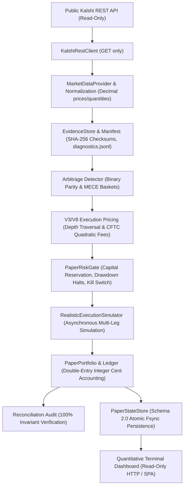
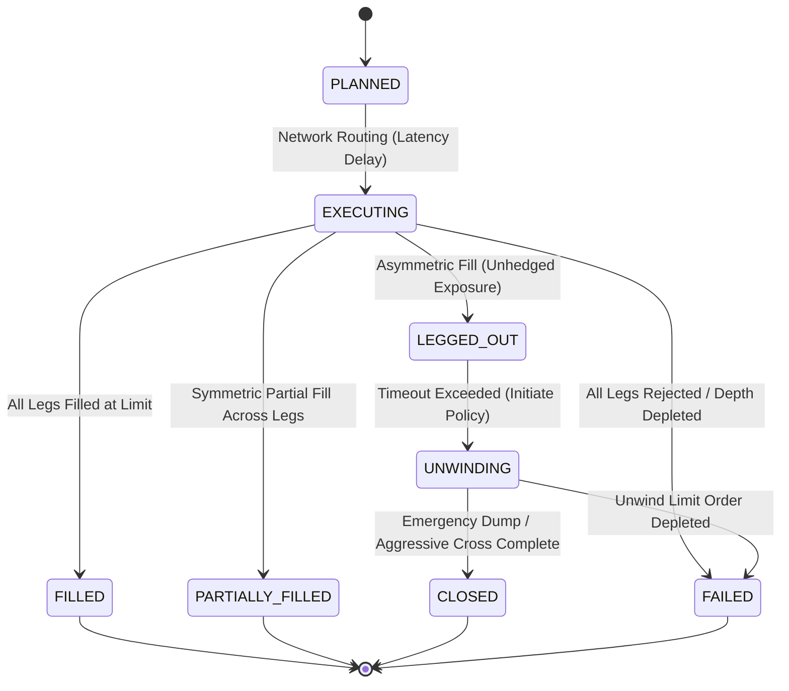

# Kalshi Arbitrage Engine

A deterministic quantitative research, market microstructure simulation, and autonomous paper-trading engine for Kalshi prediction markets (Milestones V0–V12).

> **IMPORTANT REGULATORY & SAFETY NOTICE:**
> This software is strictly a **quantitative research, market observation, and paper-trading simulation system**. It connects exclusively to read-only public REST market data endpoints. **It contains zero capabilities for real-money execution, live order routing, or account credential handling.** All trading decisions, order executions, and settlements occur in isolated, simulated paper ledgers with exact integer-cent double-entry accounting reconciliation.

---

## 1. System Architecture & Quantitative Premise

### 1.1 The Quantitative Problem: Prediction Market Arbitrage

Kalshi binary event contracts settle at exactly **\$1.00 (100¢)** if the specified event occurs, and **\$0.00 (0¢)** if it does not. This contract specification generates two deterministic mathematical arbitrage bounds:

1. **Single-Market Binary Complement Parity:**
   Because the mutually exclusive outcomes of a single binary market satisfy $\text{YES} + \text{NO} \equiv 1$, buying one YES contract and one NO contract guarantees an exact \$1.00 payout at expiration:
   $$\text{Gross Edge} = 100¢ - (P_{\text{YES, ask}} + P_{\text{NO, ask}})$$
   If $P_{\text{YES, ask}} + P_{\text{NO, ask}} < 100¢$, a theoretical gross arbitrage exists.

2. **Mutually Exclusive, Collectively Exhaustive (MECE) Event Baskets:**
   For an event partitioned into $K$ mutually exclusive and collectively exhaustive outcomes (e.g. mutually exclusive temperature bands or political outcomes), exactly one outcome will settle to \$1.00 and all others settle to \$0.00:
   $$\sum_{i=1}^K P_{i, \text{ask}} < 100¢ \implies \text{Long Basket Arbitrage}$$
   $$\sum_{i=1}^K P_{i, \text{bid}} > 100¢ \times (K - 1) \implies \text{Short Basket Arbitrage}$$

### 1.2 Microstructure Realism: Why Theoretical Arbitrage Fails

In real financial markets, simple price sum checks almost never yield executable edge:
- **Order-Book Depth Depletion:** Top-of-book quotes rarely support required size. True execution requires traversing the book levels ($P_{\text{VWAP}}$).
- **CFTC Quadratic Taker Fees:** Kalshi applies an official quadratic fee schedule:
  $$\text{Fee} = \lceil M \times \text{Rate} \times C \times P \times (1 - P) \times 100 \rceil \text{ cents}$$
  Fees peak near $50¢$ ($P(1-P) = 0.25$), consuming narrow gross edges ($1–3¢$).
- **Leg Desynchronization & Latency Decay ("Legging Out"):** Submitting sequential orders across multiple legs exposes the strategy to fill execution latency ($\sim 50\text{ms}$). If leg 1 fills but leg 2 moves adversely or cancels, unhedged directional exposure is incurred, requiring costly unwind or scratch liquidations.

---

## 2. Milestone Roadmap (V0–V12)

The engine was engineered iteratively across 13 coherent milestones:

| Milestone | Scope & Engineering Contribution |
| :--- | :--- |
| **V0 — Foundation** | Deterministic binary settlement, gross payoff vectors, positions, and portfolios using exact integer cents. |
| **V1 — Market Data** | Read-only Kalshi REST integration, strict type validation, and exact `Decimal` normalization without casting. |
| **V2 — Arbitrage Detection** | Exact mathematical detection of single-market parity and explicitly declared MECE event baskets. |
| **V3 — Execution Pricing** | Depth traversal across order-book levels, volume-weighted pricing, counterparty bid derivation ($P_{\text{ask}} = 100 - P_{\text{bid}}$), and bottleneck sizing. |
| **V4 — Paper Trading & Ledger** | Append-only financial ledger with audit reconciliation (`portfolio.reconcile()`), cash reservations, and pre-trade risk controls. |
| **V5 — Live Market Observer** | Continuous public market polling, fail-closed freshness policies using HTTP `Date` headers, timestamp skew validation, and durable storage. |
| **V6 — Historical Evaluation** | Offline chronological evaluation without look-ahead bias, fee sensitivity sweeps, and paper performance simulation. |
| **V7 — Historical Validation** | Deep evidence auditing, sampling cadence analysis, multi-stage qualification funnels, and structured 10-section research reporting. |
| **V8 — Realistic Microstructure** | Verified Kalshi CFTC quadratic fee schedule, asynchronous multi-leg lifecycle state machine, quote decay, and unwind policies (`AGGRESSIVE_CROSS`, `EMERGENCY_DUMP`). |
| **V9 — Autonomous Paper Trading** | Continuous lifecycle coordinator, resilient data provider with bounded retries, opportunity ranking, pre-trade risk gate, and schema 2.0 atomic crash recovery. |
| **V10 — Historical Strategy Validation** | Point-in-time chronological replay, 10-stage opportunity funnel, mark-to-market bid portfolio valuation, and forward out-of-sample partitioning. |
| **V11 — Sustained Evidence Collection** | Production read-only collection, isolated diagnostic failure logging (`diagnostics.jsonl`), SHA-256 integrity manifests, forward prospective paper evaluation, and non-destructive resume. |
| **V12 — Final Audit, Benchmarking & Release** | Exhaustive adversarial accounting verification, end-to-end determinism, performance profiling ($112\text{k}+$ obs/s), and portfolio release. |

---

## 3. High-Level Data Flow & State Machine

### 3.1 Data Flow Pipeline



### 3.2 Asynchronous Multi-Leg Execution Lifecycle



---

## 4. Directory & Module Structure

```text
├── kalshi_arbitrage/           # Core library package
│   ├── contract.py             # V0 binary contract & payoff model
│   ├── portfolio.py            # V0 portfolio settlement model
│   ├── market_data.py          # V1 market & order-book data models
│   ├── rest_client.py          # V1 read-only Kalshi REST API client
│   ├── arbitrage.py            # V2 deterministic arbitrage detection
│   ├── execution.py            # V3 execution pricing & depth traversal
│   ├── ledger.py               # V4 append-only financial ledger (integer cents)
│   ├── risk.py                 # V4 pre-trade risk controls
│   ├── paper_trade.py          # V4 paper trade lifecycle state machine
│   ├── paper_executor.py       # V4 paper execution simulation
│   ├── persistence.py          # V4 atomic JSON persistence (schema 1.0)
│   ├── replay.py               # V4 chronological replay engine
│   ├── observer.py             # V5 continuous live market observer
│   ├── evidence_storage.py     # V5 atomic observation persistence
│   ├── metrics.py              # V5 observer metrics & reporting
│   ├── evaluation.py           # V6 historical opportunity evaluation
│   ├── v7_validation.py        # V7 evidence auditing & qualification funnels
│   ├── fee_model.py            # V8 official CFTC quadratic fee schedule
│   ├── async_execution.py      # V8 asynchronous multi-leg execution lifecycle
│   ├── universe.py             # V8 liquid market selection & profiling
│   ├── v8_simulation.py        # V8 historical realistic execution simulator
│   ├── market_data_provider.py # V9 robust market data provider & retry handler
│   ├── opportunity_evaluator.py# V9 autonomous multi-factor opportunity evaluator
│   ├── paper_risk.py           # V9 extended pre-trade risk gate & kill switch
│   ├── paper_persistence.py    # V9 schema 2.0 atomic persistence & crash recovery
│   ├── paper_execution.py      # V9 realistic multi-leg paper execution manager
│   ├── coordinator.py          # V9 autonomous paper trading lifecycle coordinator
│   ├── v10_evaluation.py       # V10 point-in-time historical evaluation & funnels
│   ├── v11_collector.py        # V11 sustained evidence collector & forward evaluator
│   └── dashboard/              # Web dashboard backend service & static SPA
├── scripts/                    # Command-line entry points
│   ├── run_paper_trader.py     # V9 autonomous paper trading CLI
│   ├── evaluate_v10.py         # V10 historical strategy evaluation CLI
│   ├── collect_v11.py          # V11 evidence collection & prospective evaluation CLI
│   ├── benchmark_v12.py        # V12 system benchmarking & performance profiler
│   ├── run_dashboard.py        # Dashboard web server CLI
│   ├── simulate_v8.py          # V8 realistic execution simulator CLI
│   ├── run_observer.py         # V5 continuous market observer CLI
│   ├── evaluate_historical.py  # V6 historical opportunity evaluator CLI
│   └── validate_historical_v7.py # V7 deep evidence validator CLI
├── tests/                      # Comprehensive test suite (506 passing tests)
├── data/                       # Recorded observation fixtures & trial runs
├── docs/                       # Research, audit, and benchmark reports
├── ARCHITECTURE.md             # In-depth architectural specification
└── PROJECT_RULES.md            # Non-negotiable engineering principles
```

---

## 5. Engineering Performance & Benchmarks (V12)

Measured empirically on macOS ARM64 using [`scripts/benchmark_v12.py`](scripts/benchmark_v12.py) with standard library `tracemalloc` and `time.perf_counter`:

### 5.1 Real Evidence Replay Throughput
- **V5 Public Trial (21 observations):** $3,948.9$ obs/sec ($253.2\mu\text{s}$ per obs)
- **V11 Collection Trial (8 observations):** $3,651.2$ obs/sec ($273.9\mu\text{s}$ per obs)
- **V11 Prospective Paper Trial (10 observations):** $3,943.8$ obs/sec ($253.6\mu\text{s}$ per obs)

### 5.2 Synthetic Scaling Linearity ($O(N)$)
- **100 observations:** $47,892.7$ obs/sec ($20.9\mu\text{s}$ / obs; $48\text{ KB}$ peak memory)
- **500 observations:** $102,993.7$ obs/sec ($9.7\mu\text{s}$ / obs; $279\text{ KB}$ peak memory)
- **1,000 observations:** $110,105.4$ obs/sec ($9.1\mu\text{s}$ / obs; $577\text{ KB}$ peak memory)
- **5,000 observations:** $112,691.7$ obs/sec ($8.9\mu\text{s}$ / obs; $2,989\text{ KB}$ peak memory)
- **Memory footprint:** Strictly linear at $\sim 600\text{ bytes}$ per observation.

### 5.3 Microstructure Computation Speeds
- **CFTC Quadratic Fee Engine:** **$127,053$ evaluations / second** ($20,000$ calls in $0.157\text{s}$)
- **Multi-Leg Async Execution Simulator:** **$23,879$ trades / second** ($2,000$ trades in $0.084\text{s}$)
- **SHA-256 Stream Digest Throughput:** **$2,864.9\text{ MB} / \text{second}$**

---

## 6. Honest Quantitative Findings & Research Integrity

All research evaluations within this repository enforce strict scientific integrity:

1. **Empirical Public Liquidity Reality:** During public REST market polling across multiple observation trials, **100% of polled order books exhibited zero resting bid liquidity**. The public REST API returns empty depth arrays (`yes_bids=()`, `no_bids=()`) for the vast majority of event contracts outside of high-volume financial indices.
2. **True Failure Funnel Reporting:** Rather than inventing liquidity or relaxing spreads, the pipeline truthfully reports **0 qualified opportunities** and **0 executed trades**.
3. **No Inference of Market Efficiency:** A lack of detected arbitrage in an empty or sparse market sample **does not prove market efficiency**, nor does it prove that arbitrage never exists. It proves that the observed public market sample lacked executable liquidity.
4. **Final Research Verdict:** The economic strategy edge remains **`INCONCLUSIVE`**. The codebase is released as a verified, high-integrity quantitative engineering prototype, not as a profitable trading strategy.

---

## 7. CLI Quickstart & Reproducibility

### Setup Environment
```bash
python3 -m venv .venv
source .venv/bin/activate
pip install -e .
```

### Run Full Test Suite
```bash
# Runs full test suite (506 passed, 1 environment-restricted socket test excluded)
./.venv/bin/pytest tests/ -k "not test_http_api_endpoints_integration"
```

### 1. System Benchmarking (V12)
```bash
./.venv/bin/python scripts/benchmark_v12.py --output-json docs/v12_benchmark_data.json
```

### 2. Historical Strategy Evaluator (V10)
```bash
./.venv/bin/python scripts/evaluate_v10.py \
  --file data/v5_trial/observations.jsonl \
  --output-json data/v10_trial_report.json
```

### 3. Sustained Market Collector & Prospective Paper Evaluator (V11)
```bash
# Run a bounded 5-cycle read-only collection session
./.venv/bin/python scripts/collect_v11.py \
  --collect \
  --output-dir evidence_v11_session \
  --max-cycles 5 \
  --poll-interval 2.0

# Audit evidence cadence, sampling intervals, and order book mutations
./.venv/bin/python scripts/collect_v11.py \
  --audit \
  --input-dir evidence_v11_trial
```

### 4. Autonomous Paper Trader (V9)
```bash
./.venv/bin/python scripts/run_paper_trader.py \
  --max-cycles 10 \
  --poll-interval 5.0 \
  --state-file data/paper_state.json \
  --report-file data/paper_session_report.json
```

### 5. Quantitative Terminal Web Dashboard (V1)
```bash
./.venv/bin/python scripts/run_dashboard.py --port 8000
```
Open [http://localhost:8000](http://localhost:8000) to inspect real-time order books, detected opportunities, and system health.

---

## 8. License & Disclaimer

This project is licensed under the MIT License. It is intended solely for educational, quantitative research, and paper-trading simulation purposes. The authors accept no responsibility for any financial loss or regulatory non-compliance resulting from unauthorized live deployment.
