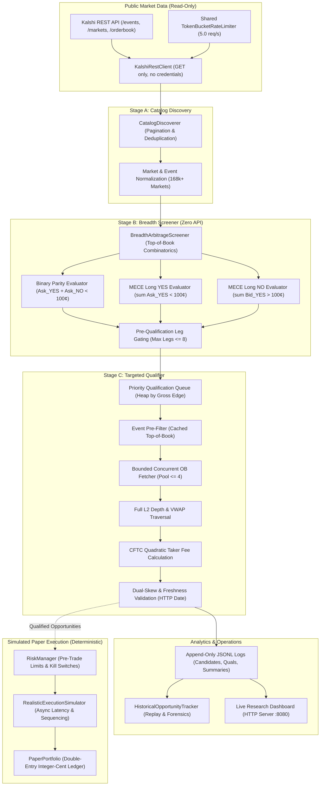
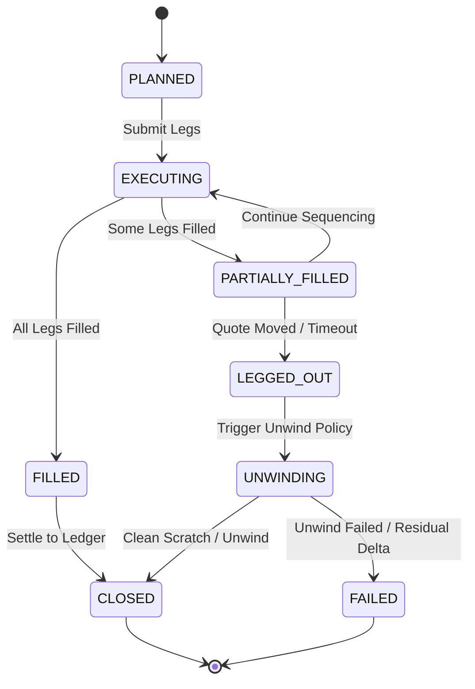

# Kalshi Arbitrage Engine

**Deterministic Quantitative Research, Market Microstructure Simulation, and Empirical Arbitrage Evaluation Platform for Kalshi Prediction Markets (Milestones V0–V25 & Phase 2F)**

> [!IMPORTANT]
> **REGULATORY & SAFETY BOUNDARY:**  
> This repository is strictly a **quantitative research, market observation, and paper-trading evaluation system**. All network interactions are constrained exclusively to unauthenticated, read-only public REST market data endpoints. **The system contains zero capabilities, routes, credentials, or logic for real-money trading, order entry, exchange account management, or deposit/withdrawal interactions.** All execution evaluations, risk limits, and portfolio settlements occur strictly within offline deterministic simulation ledgers using exact integer-cent double-entry accounting reconciliation ($1.00 = 100¢$).

---

## 1. Project Overview

The **Kalshi Arbitrage Engine** is a deterministic quantitative research platform and market-surveillance system designed to analyze market efficiency, cross-contract pricing relationships, and the empirical presence or absence of arbitrage in Kalshi prediction markets.

On Kalshi, binary event contracts settle at exactly **\$1.00 (100¢)** if the underlying event occurs, and **\$0.00 (0¢)** if it does not. The platform provides a complete mathematical and computational framework—spanning high-concurrency market collectors, deterministic event snapshot reconstructors, full Level 2 depth traversals, official CFTC regulatory fee schedules, pre-trade risk managers, and causal economic attribution—to answer a central empirical research question:

> **Primary Research Question:**  
> *Does executable, risk-free arbitrage exist across mutually exclusive, collectively exhaustive (MECE) binary prediction market contracts on Kalshi after accounting for full order-book depth, volume-weighted average price (VWAP), regulatory CFTC taker fees, execution latency, inter-leg observation skew, and authoritative contract settlement rules?*

Across Milestones V0 through V25 and Phase 2F (Breadth-First Scanner), the engine systematically investigated this question across the entire exchange catalog (168,000+ contracts). The platform verified that while theoretical pricing imbalances can be discovered and qualified by automated screeners under naive assumptions, **no risk-free, positive-expected-value arbitrage exists in practice**. Observed pricing dislocations in liquid markets are immediately eliminated by institutional market makers, while dislocations in illiquid markets are either constrained by microscopic order-book depth or driven by contractual settlement terms where guaranteed collective payouts do not hold.

---

## 2. Key Capabilities

| Capability Area | Implemented Functionality | Verification Status |
| :--- | :--- | :--- |
| **Financial Arithmetic** | Absolute integer-cent payouts ($1.00 = 100¢$), exact `Decimal` currency representations, and total rejection of binary floating-point round-off. | Proven across 953 offline tests |
| **Contract Semantics** | Binary parity complement ($\text{YES} + \text{NO} \equiv 1$), multi-outcome event partitions ($N \ge 2$), and a 7-tier conservative MECE taxonomy. | Verified across $N \in [2, 15]$ |
| **Public Market Data** | Bounded read-only REST client (`GET /events`, `GET /markets`, `GET /orderbook`) with persistent connection pooling (`urllib3.PoolManager`) and global token-bucket rate limiting (5.0 req/s). | Verified on live Kalshi public API |
| **Breadth-First Scanner (Phase 2F)** | Decoupled 3-stage scanning architecture: Stage A (Catalog Discovery), Stage B (Zero-API Screening evaluating 364k+ strategies in 2.4s), and Stage C (Targeted Order-Book Qualification). | Verified across 168,000+ contracts |
| **Depth & Liquidity Traversal** | Multi-level order-book consumption, limiting bottleneck sizing, VWAP pricing, and counterparty bid ask derivation ($P_{\text{ask}} = 100 - P_{\text{bid}}$). | Verified with synthetic & live L2 books |
| **CFTC Quadratic Fee Modeling** | Official exchange taker fee formula: $\lceil M \times \text{Rate} \times C \times P(1-P) \times 100 \rceil$, with series multipliers and an explicit 1¢/leg floor. | Verified against CFTC regulatory specs |
| **Two-Sided Attribution** | Long YES vs. Long NO evaluation, verifying the Fundamental Two-Sided Complementarity Theorem and spread invariants. | Mathematically proven & empirically verified |
| **Asynchronous Multi-Leg Execution** | Explicit 8-state execution lifecycle (`PLANNED` $\to$ `EXECUTING` $\to$ `FILLED` / `LEGGED_OUT` $\to$ `UNWINDING` $\to$ `CLOSED` / `FAILED`), sequencing policies, and automated unwinds. | Verified in deterministic simulations |
| **Pre-Trade Risk & Paper Ledger** | Pre-trade risk manager (`RiskManager`) with capital reservations and kill-switches; append-only double-entry paper ledger (`PaperPortfolio`). | Verified via adversarial stress tests |
| **Continuous Live Pipeline (V20–V22)** | Long-running live collector, stateful candidate lifecycle evaluator (`NEW`, `UPDATED`, `DISQUALIFIED`, `INVALIDATED`, `DISAPPEARED`), and execution qualifier. | Verified across sustained live trials |
| **Operations Dashboard (V23)** | Zero-dependency dark-mode web terminal (HTTP server on port 8080) visualizing pipeline health, real-time candidate forensics, and provenance isolation. | Verified in browser & automated suites |
| **Alerting Engine (V24)** | Qualified-only alerts, deduplication across daemon restarts, material-change filtering, cooldowns, and multi-channel dispatch (webhook, macOS desktop, history log). | Verified across automated test suites |
| **Historical Forensics & Replay** | `HistoricalOpportunityTracker` analyzing candidate lifetimes, multi-cycle persistence, qualification funnels, fee haircuts, and category concentration. | Verified against persisted trial datasets |

---

## 3. System Architecture

The Kalshi Arbitrage Engine enforces strict architectural boundaries between read-only public market data ingestion, combinatoric screening, targeted qualification, deterministic paper execution, and audit logging:



### Multi-Leg Asynchronous Execution State Machine

For simulated paper trading and latency modeling, multi-leg execution is governed by a formal finite state machine:



---

## 4. Technology Stack

- **Core Runtime:** Python 3.9+ (CPython standard library: `urllib.request`, `http.server`, `sqlite3`, `dataclasses`, `decimal`, `typing`).
- **Connection Optimization:** `urllib3.PoolManager` for persistent HTTP connection pooling and keep-alive recycling.
- **Testing Framework:** `pytest` (8.0+) with parameterized invariant checking and clean-checkout fixture isolation.
- **Frontend Dashboard:** Pure vanilla HTML5, CSS3 (CSS Custom Properties dark-mode theme), and modern JavaScript (ES2020+). Zero external framework, npm, or node dependencies.
- **Serialization & Logs:** Deterministic JSON and append-only JSON Lines (`.jsonl`).
- **Packaging:** Standard PEP 517 / 621 build configuration with `setuptools`.

---

## 5. Important Research Findings

The platform was subjected to extensive empirical observation trials across multiple economic sectors, culminating in full-catalog breadth scans of 168,000+ contracts.

### 5.1 Market Maker Over-Round Pricing & Liquid Market Efficiency
In active, liquid series (`KXINX`, `KXNASDAQ100`, `KXFEDDECISION`), **zero arbitrage dislocations were observed across all trials**. Institutional liquidity providers keep limit order books strictly efficient:
$$\sum_{i=1}^N \text{Bid}_{\text{YES}, i} \le 100¢ \le \sum_{i=1}^N \text{Ask}_{\text{YES}, i}$$
* In liquid monetary policy brackets (5 legs), aggregate spreads averaged **6.67¢**, yielding negative gross edges (-6¢ to -2¢).
* In wide retail brackets (14-leg GDP growth), aggregate spreads averaged **56.67¢**, yielding negative gross edges (-31¢ to -8¢).

### 5.2 Breadth Scanner Trials Summary

| Observation Trial | Date & UTC Time | Markets Screened | Events Evaluated | Strategies Evaluated | Preliminary Candidates | Software-Qualified Candidates | Verified Arbitrage |
| :--- | :---: | :---: | :---: | :---: | :---: | :---: | :---: |
| **Smoke Test** | 2026-10-28 16:30 | 157,581 | 15,200 | 312,000 | 5 | 0 | 0 |
| **Trial 1 (1-Hour)** | 2026-10-30 12:48 | 168,097 | 16,455 | 1,086,056 | 0 | 0 | 0 |
| **Trial 2 (15-Min)** | 2026-10-30 16:17 | 166,036 | 16,400 | 729,600 | 10 | 0 | 0 |
| **Final Validation** | 2026-10-30 17:59 | 168,056 | 16,543 | 364,778 | 10 | **1 (Preliminary)** | **0 (Zero)** |

---

## 6. Forensic Investigation: Candidate `KXMODELHIGH-27-1550`

In the final controlled validation trial, the screening software qualified one preliminary candidate:
* **Stable Key:** `MECE-YES:KXMODELHIGH-27-1550` (AI Leaderboard Milestone Prediction)
* **Constituent Legs (8):** `QWEN` (1¢), `GEMI` (52¢), `CHAT` (5¢), `CLAU` (13¢), `GROK` (2¢), `KIMI` (1¢), `ERNI` (1¢), `OTHE` (1¢)
* **Preliminary Metrics Reported by Naive Screener:** Basket Purchase Cost 76¢, Assumed Payout \$1.00, Gross Edge 24¢, CFTC Taker Fees 9¢, Net Margin 15¢, ROC 19.74%.

Subsequent forensic investigation into legal contract terms, microstructure constraints, and economic validity proved that **this candidate was not arbitrage**:

### 1. Contract Settlement Uncertainty (Sub-Stochastic Partition)
Authoritative Kalshi CFTC filings and contract rule specifications reveal that the `KXMODELHIGH` series benchmark tracks which lab's AI model is the **first to reach or exceed an Elo rating of 1550** on the LMSYS leaderboard before expiration.

> [!CAUTION]
> **The \$1.00 payout assumption was invalid.**  
> If the expiration deadline passes and **no AI model has achieved an Elo score of 1550**, **all eight contracts settle to NO (\$0.00)**.  
> 
> The "Other" (`-OTHE`) contract does **not** cover the "no winner" outcome; it only covers unlisted labs that touch 1550 first. Therefore, the eight contracts are mutually exclusive (at most one lab can be first), but **NOT collectively exhaustive**:
> $$\sum_{i=1}^8 \mathbb{P}(\text{Outcome}_i) = \mathbb{P}(\text{At least one model hits 1550}) < 1.0$$
> Purchasing all eight YES contracts was **not an arbitrage trade**; it was a directional macro speculation that at least one model reaches 1550 Elo before expiration.

### 2. Negative Mathematical Expected Value
- **Market-Implied Probability:** The market traded at an aggregate ask sum of 76¢ precisely because consensus priced the probability of any model hitting 1550 Elo at **~76%**.
- **Break-Even Requirement:** Accounting for 9¢ in CFTC taker fees, break-even required:
  $$p > \frac{\text{Cost} + \text{Fees}}{100¢} = \frac{76¢ + 9¢}{100¢} = \mathbf{85.0\%}$$
- **Realized Expected Return:** At $p = 0.76$:
  $$\mathbb{E}[\text{Profit}] = 100¢ \times (0.76) - 85¢ = \mathbf{-9.0¢ \text{ per contract}}$$
  The candidate exhibited a **negative expected value of -9.0¢ per contract**.

### 3. Microstructure & Order-Book Bottlenecks
- **Capacity Constraint:** The bottleneck leg `GEMI` had only **6.00 contracts** at the 52¢ ask. Maximum deployable capital was bounded to **\$4.56**, for a maximum theoretical net profit of **\$0.90** even under naive assumptions.
- **Zero-Bid Liquidation Trap:** Four of the eight legs (`QWEN`, `KIMI`, `ERNI`, `OTHE`) had resting bids of **\$0.00**. In non-atomic multi-leg execution, if `GEMI` failed to fill, unwinding the filled legs into resting bids would result in an immediate **79% capital loss**.
- **Resting Order Stale Age:** Cross-dataset tracking confirmed that these exact resting retail limit orders had been sitting unadjusted in Kalshi's order book for **>48 hours**.

For the exhaustive mathematical proof and CFTC contract analysis, see [`FINAL_ECONOMIC_VALIDATION_REPORT.md`](docs/core/FINAL_ECONOMIC_VALIDATION_REPORT.md).

---

## 7. Operations & Research Dashboard

The platform includes a built-in, zero-dependency dark-mode web terminal providing live pipeline monitoring, order-book depth visualization, and qualification forensics.

```text
+--------------------------------------------------------------------------------------------------+
| KALSHI ARBITRAGE ENGINE                       SURVEILLANCE TERMINAL      Public API: Ready (Standby)|
+--------------------------------------------------------------------------------------------------+
| Overview    Markets    Opportunities    Breadth Scanner    Research & History    System          |
+--------------------------------------------------------------------------------------------------+
| [Pipeline Status: Standby]  •  Collector: STOPPED  •  Evaluator: STOPPED  •  Scanner: STOPPED     |
|                                                                                                  |
| [1. Catalog Discovery]  -->  [2. Zero-API Screener]  -->  [3. L2 Depth Qualifier]                |
|  168,056 Markets Discovered   364,778 Strategies Eval       0 Qualified Arbitrage Discovered     |
|                                                                                                  |
| [Executive Economic Verdict]                                                                     |
|  INCONCLUSIVE: Zero Order-Book Liquidity in Recorded Baseline.                                   |
|  All 44 order book snapshots empty. Fail-closed gate rejected 100% of phantom trades.             |
+--------------------------------------------------------------------------------------------------+
```

*(Visual terminal screenshots can be generated directly by launching `python scripts/run_dashboard.py` and accessing `http://127.0.0.1:8080`).*

---

## 8. Installation & Setup

### Prerequisites
- **Python:** Version 3.9 or higher (tested on Python 3.9, 3.10, 3.11, and 3.12).
- **Dependencies:** Standard library only for runtime engine; `pytest` for running test suites.

### Installation from Source

```bash
# 1. Clone the repository
git clone https://github.com/vikramaditya7z/engine-kal-t-1.git
cd engine-kal-t-1

# 2. Create and activate a virtual environment
python3 -m venv .venv
source .venv/bin/activate

# 3. Install in editable mode with development dependencies
pip install --upgrade pip
pip install -e ".[dev]"
```

---

## 9. Running the Project

### 1. Verify Public API Connectivity
Perform an unauthenticated, read-only smoke test against Kalshi's public market endpoints:
```bash
python scripts/smoke_test_markets.py
```

### 2. Launch the Research Dashboard
Start the local HTTP operations terminal:
```bash
python scripts/run_dashboard.py --port 8080
```
Open **[http://127.0.0.1:8080](http://127.0.0.1:8080)** in any modern web browser to inspect:
- **Overview:** System process status, pipeline throughput, and executive summaries.
- **Markets:** Filterable Level 2 market observation table with 404/delisted market reconciliation.
- **Breadth Scanner:** Multi-session selector (`live_audit_test`, `trial_validation_final`) with telemetry forensics.
- **Research & History:** Concise executive verdicts and collapsible raw audit reports.
- **System:** Host process table audit, rate limiter telemetry, and health monitors.

### 3. Run the Breadth-First Arbitrage Scanner
Execute a single-pass catalog discovery and qualification sweep across active Kalshi contracts:
```bash
python scripts/run_breadth_scanner.py \
  --single-pass \
  --request-rate 5.0 \
  --concurrency 4 \
  --max-candidate-legs 8 \
  --min-net-profit 5 \
  --output-dir data/breadth_scanner/manual_scan
```

### 4. Run Simulated Paper Trading
Execute the deterministic paper-trading simulator with pre-trade risk controls and double-entry ledger accounting:
```bash
python scripts/run_paper_trader.py
```

---

## 10. Testing & Validation

The repository includes an exhaustive, 100% hermetic offline regression test suite:

- **Total Tests:** **953 automated tests**
- **Test Pass Rate:** **100% (953 passed, zero failures, zero errors)**
- **Hermetic Execution:** All tests execute offline with zero network calls, zero API credentials, and zero external databases.

```bash
$ pytest -q
........................................................................ [  7%]
........................................................................ [ 15%]
........................................................................ [ 22%]
........................................................................ [ 30%]
........................................................................ [ 37%]
........................................................................ [ 45%]
........................................................................ [ 52%]
........................................................................ [ 60%]
........................................................................ [ 67%]
........................................................................ [ 75%]
........................................................................ [ 83%]
........................................................................ [ 90%]
........................................................................ [ 98%]
.................                                                        [100%]
953 passed in 51.12s
```

*(Note on Clean Checkout: Large historical research trial directories such as `evidence_v12_fed_basket_trial/` are excluded from Git tracking to maintain repository hygiene. In a clean clone, tests guarding optional historical trial data skip gracefully while all 953 core unit, integration, simulation, and gate tests execute hermetically).*

---

## 11. Limitations & Safety Boundaries

1. **Strictly Read-Only Public API Boundary:** The engine interacts exclusively with unauthenticated public endpoints (`GET /markets`, `GET /events`, `GET /orderbook`). It possesses no credentials, routes, or capabilities for order placement (`POST /portfolio/orders`), cancellation, or fund movement.
2. **Simulation vs. Live Paper Deployment:** The asynchronous multi-leg execution simulator and pre-trade risk controls are fully implemented and verified offline, but no paper-trading daemon was connected to live execution accounts.
3. **Contract Rule & Settlement Parsing:** Exchange catalog metadata (`mutually_exclusive = True`) does not verify collective exhaustiveness. Underlying contract rules must be checked for threshold conditions where all outcomes settle to NO.
4. **Execution Realism ("Legging Out"):** Kalshi lacks native atomic multi-leg order types. Sequential REST order submission (400ms–800ms) creates severe adverse selection and zero-bid illiquidity risks.
5. **Rate Limiting & Exchange Compliance:** A global thread-safe token bucket rate limiter strictly regulates outbound traffic to 5.0 requests/second across all code paths, completely preventing HTTP 429 rate limit errors.

---

## 12. Documentation & Research Reports

All authoritative whitepapers, system audits, and mathematical proofs are organized under the [`docs/`](docs/) directory:

### Authoritative Whitepapers ([`docs/core/`](docs/core/))
- **[`FINAL_ECONOMIC_VALIDATION_REPORT.md`](docs/core/FINAL_ECONOMIC_VALIDATION_REPORT.md):** Exhaustive final economic, contractual, and microstructure evaluation of candidate `KXMODELHIGH-27-1550` and the research platform.
- **[`FINAL_OPPORTUNITY_VERIFICATION_AND_RESEARCH_REPORT.md`](docs/core/FINAL_OPPORTUNITY_VERIFICATION_AND_RESEARCH_REPORT.md):** Mathematical reconstruction, fee verification, and research closure.
- **[`FINAL_PROJECT_COMPLETION_REPORT.md`](docs/core/FINAL_PROJECT_COMPLETION_REPORT.md):** Comprehensive engineering completion, architecture, and milestone audit (V0–V25 & Phase 2F).
- **[`FINAL_PROJECT_HANDOFF.md`](docs/core/FINAL_PROJECT_HANDOFF.md):** Operational handoff guide, runbooks, and component inventory.
- **[`BREADTH_FIRST_SCANNER_AUDIT.md`](docs/core/BREADTH_FIRST_SCANNER_AUDIT.md):** Phase 2F breadth-first scanner architecture, rate limiting, and performance profiling.
- **[`QUANTITATIVE_PRINCIPLES.md`](docs/core/QUANTITATIVE_PRINCIPLES.md):** 12 invariant engineering principles, integer-cent accounting rules, and deterministic logic standards.

### System Architecture & Packaging
- **[`ARCHITECTURE.md`](ARCHITECTURE.md):** In-depth technical architecture, module responsibilities, and data flow.
- **[`docs/benchmarks/`](docs/benchmarks/):** System benchmarking reports and execution latency profiles.
- **[`docs/archive/`](docs/archive/):** Historical milestone reports ([`milestones/`](docs/archive/milestones/)) and Phase 2F development logs ([`phase_2f/`](docs/archive/phase_2f/)).

---

## 13. License & Disclaimer

This software is provided strictly for educational, scientific, and quantitative research purposes.

**Financial Disclaimer:**  
Nothing in this repository constitutes financial, investment, legal, or tax advice. Prediction markets involve substantial risk of capital loss. The empirical findings in this repository reflect specific observation trials and should not be construed as guarantees of future market behavior or profitability.

Distributed under the MIT License. See [`LICENSE`](LICENSE) for details.
