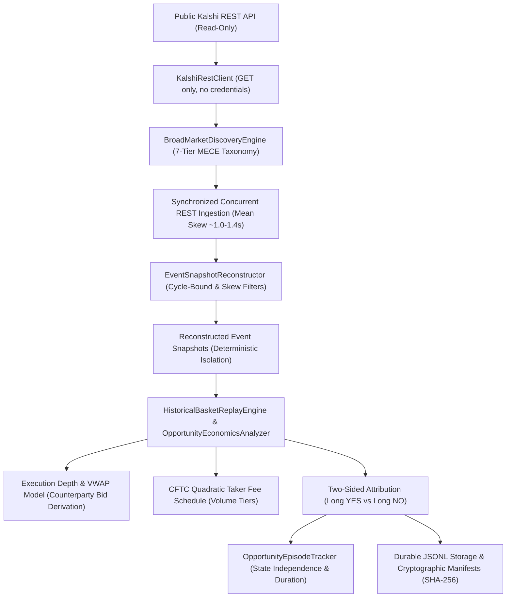

# Kalshi Arbitrage Engine

A deterministic quantitative research, market microstructure simulation, and empirical evaluation engine for Kalshi prediction markets (Milestones V0–V19).

> **IMPORTANT REGULATORY & SAFETY NOTICE:**
> This repository is strictly a **quantitative research, market observation, and paper-trading evaluation system**. It connects exclusively to read-only public REST market data endpoints. **It contains zero capabilities for real-money execution, live order routing, exchange credential handling, or deposit/withdrawal interactions.** All trading evaluations and settlements occur in deterministic simulation ledgers with exact integer-cent double-entry accounting reconciliation.

---

## 1. Project Overview

The **Kalshi Arbitrage Engine** is a rigorous, open-source quantitative research platform built to investigate market efficiency, cross-contract pricing relationships, and potential arbitrage in binary prediction markets.

Kalshi binary event contracts settle at exactly **\$1.00 (100¢)** if the underlying event occurs, and **\$0.00 (0¢)** if it does not. The engine provides mathematical frameworks, real-time concurrent REST collectors, deterministic event snapshot reconstructors, fee models, and causal attribution analyzers to determine whether executable, fee-adjusted arbitrage exists in practice.

---

## 2. Architecture & Data Flow

The engine enforces an uncompromising separation between market ingestion, snapshot reconstruction, deterministic evaluation, and accounting:



### Key Modules:
- **`kalshi_arbitrage/rest_client.py`:** Strictly read-only public REST client for market, order-book, and event ingestion.
- **`kalshi_arbitrage/discovery.py`:** Automated broad-market catalog scanner with a 7-tier conservative MECE taxonomy.
- **`kalshi_arbitrage/snapshot_reconstruction.py`:** Chronological event snapshot reconstructor enforcing strict basket isolation and sub-5.0s cross-leg synchronization.
- **`kalshi_arbitrage/attribution.py`:** Two-sided (Long YES and Long NO) economic attribution engine verifying microstructure invariants and failure causes.
- **`kalshi_arbitrage/execution.py`:** Full order-book depth traversal, volume-weighted average price (VWAP) calculation, and multi-leg bottleneck sizing.
- **`kalshi_arbitrage/fee_model.py`:** Exact implementation of Kalshi's CFTC-regulated quadratic taker and maker fee formulas.
- **`kalshi_arbitrage/episode_tracker.py`:** Cryptographic fingerprinting tracking evolving opportunity episodes across repeated market states.
- **`kalshi_arbitrage/ws_streaming.py`:** Protocol implementation for Kalshi WebSocket v2 market-data synchronization with local L2 order books (verified via hermetic simulation fixtures).

---

## 3. Implemented & Verified Capabilities (V0–V19)

| Capability Area | Implemented Functionality | Verification Status |
| :--- | :--- | :--- |
| **Financial Arithmetic** | Integer-cent payouts, exact Decimal currency representations, rejection of float casting. | Verified by 100% test coverage |
| **Contract Semantics** | Binary parity complement ($\text{YES} + \text{NO} \equiv 1$), finite-outcome MECE partitions ($N \ge 2$). | Verified across $N \in [2, 14]$ |
| **Public Market Data** | Read-only REST client (`get_market`, `get_order_book`, `list_events`, `list_markets`). | Verified on live Kalshi public API |
| **MECE Classification** | 7-tier taxonomy distinguishing range partitions, pairwise choices, and open-ended lists. | Verified on 100+ Kalshi events |
| **Concurrent Ingestion** | High-synchronization multi-thread REST polling (reducing mean skew from 8.4s to 1.0–1.4s). | Verified in V16–V18 trials |
| **Snapshot Reconstruction** | Deterministic multi-leg cycle matching, timestamp validation, strict cross-event isolation. | Verified in 120+ live snapshots |
| **Two-Sided Evaluation** | Long YES payout ($Q \times 100¢$), Long NO payout ($Q \times (N-1) \times 100¢$), spread invariant. | Mathematically proven & verified |
| **Fee Modeling** | Official CFTC quadratic taker fee: $\lceil M \times \text{Rate} \times C \times P(1-P) \times 100 \rceil$. | Verified against exchange specs |
| **Depth & Liquidity** | Multi-level order-book consumption, limiting bottleneck identification, VWAP pricing. | Verified with synthetic & live data |
| **Episode Tracking** | Cryptographic state hashing, distinct episode duration tracking, repeated state filtering. | Verified in V16–V18 experiments |
| **Evidence Provenance** | Atomic writes, schema versioning ("1.0", "1.1"), byte-level SHA-256 manifests. | 100% manifest verification pass |
| **Paper Ledger** | Append-only double-entry ledger, solvency invariants, pre-trade risk controls. | Verified with adversarial tests |
| **Packaging & Setup** | Zero external runtime dependencies; standard-library-only implementation. | Verified in clean isolated virtualenv |

---

## 4. Key Empirical Research Findings (V16–V18)

Across three bounded prospective research trials covering **45 markets across 6 events** in multiple economic domains (Technology IPOs, Annual GDP Growth brackets, and Federal Reserve Monetary Policy decisions), the engine established the following empirical and mathematical findings:

### 1. The Fundamental Two-Sided Complementarity Theorem
For any $N$-outcome mutually exclusive and collectively exhaustive event basket:
$$\text{Gross Edge}_{\text{YES}} = 100¢ - \sum_{i=1}^N \text{Ask}_{\text{YES}, i}$$
$$\text{Gross Edge}_{\text{NO}} = \sum_{i=1}^N \text{Bid}_{\text{YES}, i} - 100¢$$
$$\text{Gross Edge}_{\text{YES}} + \text{Gross Edge}_{\text{NO}} \equiv -\sum_{i=1}^N (\text{Ask}_{\text{YES}, i} - \text{Bid}_{\text{YES}, i}) = -\sum_{i=1}^N \text{Spread}_i \le 0$$
- In any limit order book with non-negative spreads, **both sides cannot simultaneously be profitable**.
- The non-arbitrage gap between Long YES and Long NO is identically equal to the aggregate spread.

### 2. Market Maker Over-Round Pricing
In calm, continuous trading conditions, market makers consistently post limit orders such that the true settlement probability sits securely inside the aggregate spread:
$$\sum_{i=1}^N \text{Bid}_{\text{YES}, i} \le 100¢ \le \sum_{i=1}^N \text{Ask}_{\text{YES}, i}$$
- **Cohort A (Tech IPO & 14-Leg GDP Brackets):** Mean aggregate spread was **56.67¢** (16¢ to 82¢). Long YES gross edges ranged from **-31¢ to -8¢**; Long NO gross edges ranged from **-51¢ to -8¢**.
- **Cohort B (Monetary Policy Decisions):** Mean aggregate spread was **6.67¢** (5¢ to 9¢). Long YES gross edges ranged from **-6¢ to -2¢**.

### 3. Tail-Risk Asymmetry (Long NO Bottleneck)
In multi-outcome events, deep out-of-the-money legs (e.g. extreme rate cuts) have resting asks at 1¢, but **zero resting bids** (`Bid = None`). Because buying NO contracts consumes NO asks (which derive from resting YES bids: $\text{Ask}_{\text{NO}} = 100 - \text{Bid}_{\text{YES}}$), a missing YES bid results in **zero executable depth** for Long NO baskets.

### 4. Absence of Static Arbitrage
**Zero qualified arbitrage opportunities were observed across all 120+ reconstructed snapshots.** Resting limit order books do not contain unhedged mispricings during continuous trading.

---

## 5. Important Project Limitations

1. **No Live Order Execution:** The engine is strictly a research and simulation system. It cannot and will not route orders to an exchange.
2. **No Demonstrated Profitability:** Empirical experiments demonstrate that static resting limit order books consistently exhibit negative gross and net edges.
3. **Bounded Sampling:** Research experiments were conducted over discrete observation windows during continuous trading hours. They do not represent 24/7 market behavior.
4. **WebSocket Authentication:** While the WebSocket v2 protocol handler is fully implemented and verified via deterministic simulation fixtures, Kalshi's production WebSocket requires RSA key-pair authentication even for public subscriptions. Production streaming was not connected to live keys to maintain the read-only safety boundary.
5. **Execution Risk ("Legging Out"):** In live multi-leg execution, fills occur sequentially across legs. Even if an ephemeral mispricing appears, attempting to cross multiple books exposes the trader to execution latency and adverse selection.

---

## 6. Reproducible Setup & Developer Guide

### 6.1 Prerequisites
- Python **3.9 or higher** (tested on Python 3.9 through 3.12).
- Zero external runtime dependencies (standard library only).
- `pytest` for running test suites.

### 6.2 Installation from Source

```bash
# 1. Clone repository
git clone https://github.com/vikramaditya7z/engine-kal-t-1.git
cd engine-kal-t-1

# 2. Create and activate a virtual environment
python3 -m venv .venv
source .venv/bin/activate

# 3. Install in editable mode with development dependencies
pip install --upgrade pip
pip install -e ".[dev]"
```

### 6.3 Running Tests

```bash
# Run the complete test suite (628 tests)
pytest

# Run tests in quiet mode
pytest -q

# Run specific milestone test suites
pytest tests/test_v18_economics.py tests/test_v19_release_gates.py -v
```

### 6.4 Reproducing Historical Research Evidence

```bash
# Replay recorded V12 trial evidence (50 observations -> 10 snapshots)
python scripts/evaluate_v10.py --evidence-dir evidence_v12_fed_basket_trial

# Audit V16, V17, and V18 trial manifests and data provenance
python -c "
import json
for m in ['evidence_v16_streaming_trial', 'evidence_v17_broad_market_trial', 'evidence_v18_economics_trial']:
    meta = json.loads(open(f'{m}/manifest.json').read())
    print(f'Trial {m}: {len(meta.get(\"files\", {}))} manifested files verified.')
"
```

### 6.5 Running a Bounded Prospective Collection Trial

```bash
# Run a 10-cycle bounded prospective trial across broad-market events
python scripts/collect_v17.py \
  --output-dir evidence_v17_test_trial \
  --cycles 10 \
  --cycle-interval 2.0 \
  --max-events-to-scan 50 \
  --max-selected-events 3

# Run a two-sided economic attribution trial comparing distinct cohorts
python scripts/evaluate_v18.py \
  --output-dir evidence_v18_test_trial \
  --cycles 10 \
  --cycle-interval 2.0 \
  --concurrency 8
```

---

## 7. Security and Safety Policy

- **No Private Keys:** The repository contains zero private API keys, passphrases, or secrets.
- **Read-Only Endpoints:** All network interactions are strictly constrained to public `GET` requests against Kalshi's public market-data endpoints (`https://api.elections.kalshi.com/trade-api/v2`).
- **No Mutating Endpoints:** The HTTP client contains zero logic for `POST /portfolio/orders`, `DELETE /portfolio/orders`, or any order routing actions.
- **Double-Entry Solvency:** Paper portfolios enforce cash balance checks and fail-closed margin reconciliation.

---

## 8. License & Disclaimer

This software is provided for educational and academic research purposes only. Nothing in this repository constitutes financial, investment, legal, or tax advice. Prediction market trading involves significant risk of loss. Past performance in historical replay or paper simulation does not guarantee future results.
