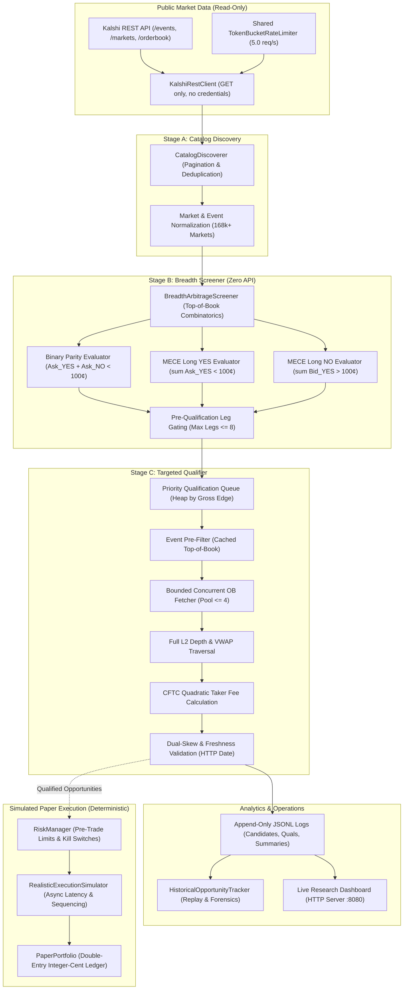
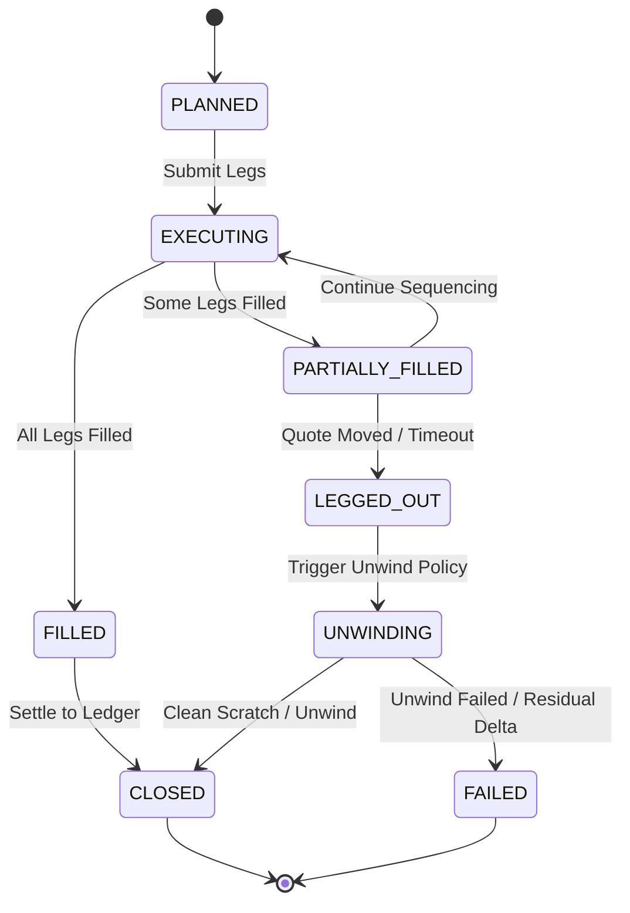

# Kalshi Arbitrage Engine

**Engineering-Complete Quantitative Research, Market Microstructure Simulation, and Empirical Arbitrage Evaluation Platform for Kalshi Prediction Markets (Milestones V0–V25 & Phase 2F)**

> [!IMPORTANT]
> **REGULATORY & SAFETY BOUNDARY:**  
> This repository is strictly a **quantitative research, market observation, and paper-trading evaluation system**. All network interactions are constrained exclusively to unauthenticated, read-only public REST market data endpoints. **The system contains zero capabilities, routes, credentials, or logic for real-money trading, order entry, exchange account management, or deposit/withdrawal interactions.** All execution evaluations, risk limits, and portfolio settlements occur strictly within offline deterministic simulation ledgers using exact integer-cent double-entry accounting reconciliation ($1.00 = 100¢$).

---

## 1. Project Overview

The **Kalshi Arbitrage Engine** is a deterministic quantitative research platform and market-surveillance system designed to analyze market efficiency, cross-contract pricing relationships, and the empirical presence or absence of arbitrage in Kalshi prediction markets.

On Kalshi, binary event contracts settle at exactly **\$1.00 (100¢)** if the underlying event occurs, and **\$0.00 (0¢)** if it does not. The platform provides a complete mathematical and computational framework—spanning high-concurrency market collectors, deterministic event snapshot reconstructors, full Level 2 depth traversals, official CFTC regulatory fee schedules, pre-trade risk managers, and causal economic attribution—to answer a central empirical research question:

> **Primary Research Question:**  
> *Does executable, risk-free arbitrage exist across mutually exclusive, collectively exhaustive (MECE) binary prediction market contracts on Kalshi after accounting for full order-book depth, volume-weighted average price (VWAP), regulatory CFTC taker fees, execution latency, inter-leg observation skew, and authoritative contract settlement rules?*

Across Milestones V0 through V25 and Phase 2F (Breadth-First Scanner), the engine systematically investigated this question across the entire exchange catalog (168,000+ contracts). The platform verified that while theoretical pricing imbalances can be discovered and qualified by automated screeners under naive assumptions, **no risk-free, positive-expected-value arbitrage exists in practice**. Observed pricing dislocations in liquid markets are immediately eliminated by institutional market makers, while dislocations in illiquid markets are either constrained by microscopic order-book depth or driven by contractual settlement terms where guaranteed collective payouts do not hold.

---

## 2. Key Capabilities

| Capability Area | Implemented Functionality | Verification Status |
| :--- | :--- | :--- |
| **Financial Arithmetic** | Absolute integer-cent payouts ($1.00 = 100¢$), exact `Decimal` currency representations, and total rejection of binary floating-point round-off. | Proven across 946 offline tests |
| **Contract Semantics** | Binary parity complement ($\text{YES} + \text{NO} \equiv 1$), multi-outcome event partitions ($N \ge 2$), and a 7-tier conservative MECE taxonomy. | Verified across $N \in [2, 15]$ |
| **Public Market Data** | Bounded read-only REST client (`GET /events`, `GET /markets`, `GET /orderbook`) with persistent connection pooling (`urllib3.PoolManager`) and global token-bucket rate limiting (5.0 req/s). | Verified on live Kalshi public API |
| **Breadth-First Scanner (Phase 2F)** | Decoupled 3-stage scanning architecture: Stage A (Catalog Discovery), Stage B (Zero-API Screening evaluating 364k+ strategies in 2.4s), and Stage C (Targeted Order-Book Qualification). | Verified across 168,000+ contracts |
| **Depth & Liquidity Traversal** | Multi-level order-book consumption, limiting bottleneck sizing, VWAP pricing, and counterparty bid ask derivation ($P_{\text{ask}} = 100 - P_{\text{bid}}$). | Verified with synthetic & live L2 books |
| **CFTC Quadratic Fee Modeling** | Official exchange taker fee formula: $\lceil M \times \text{Rate} \times C \times P(1-P) \times 100 \rceil$, with series multipliers and an explicit 1¢/leg floor. | Verified against CFTC regulatory specs |
| **Two-Sided Attribution** | Long YES vs. Long NO evaluation, verifying the Fundamental Two-Sided Complementarity Theorem and spread invariants. | Mathematically proven & empirically verified |
| **Asynchronous Multi-Leg Execution** | Explicit 8-state execution lifecycle (`PLANNED` $\to$ `EXECUTING` $\to$ `FILLED` / `LEGGED_OUT` $\to$ `UNWINDING` $\to$ `CLOSED` / `FAILED`), sequencing policies, and automated unwinds. | Verified in deterministic simulations |
| **Pre-Trade Risk & Paper Ledger** | Pre-trade risk manager (`RiskManager`) with capital reservations and kill-switches; append-only double-entry paper ledger (`PaperPortfolio`). | Verified via adversarial stress tests |
| **Continuous Live Pipeline (V20–V22)** | Long-running live collector, stateful candidate lifecycle evaluator (`NEW`, `UPDATED`, `DISQUALIFIED`, `INVALIDATED`, `DISAPPEARED`), and execution qualifier. | Verified across sustained live trials |
| **Operations Dashboard (V23)** | Zero-dependency dark-mode web terminal (HTTP server on port 8080) visualizing pipeline health, real-time candidate forensics, and provenance isolation. | Verified in browser & automated suites |
| **Alerting Engine (V24)** | Qualified-only alerts, deduplication across daemon restarts, material-change filtering, cooldowns, and multi-channel dispatch (webhook, macOS desktop, history log). | Verified across automated test suites |
| **Historical Forensics & Replay** | `HistoricalOpportunityTracker` analyzing candidate lifetimes, multi-cycle persistence, qualification funnels, fee haircuts, and category concentration. | Verified against persisted trial datasets |

---

## 3. System Architecture

The Kalshi Arbitrage Engine enforces strict architectural boundaries between read-only public market data ingestion, combinatoric screening, targeted qualification, deterministic paper execution, and audit logging:



### Multi-Leg Asynchronous Execution State Machine

For simulated paper trading and latency modeling, multi-leg execution is governed by a formal finite state machine:



---

## 4. Technical Implementation

### 4.1 Component Inventory

* **`kalshi_arbitrage/rest_client.py`:** Standard-library-based GET-only client for listing events, markets, and order books. Reuses HTTP connections via `urllib3.PoolManager` and honors cursor pagination.
* **`kalshi_arbitrage/breadth_scanner.py`:** Core breadth-first scanner coordinating Stage A catalog discovery, Stage B zero-API screening, Stage C targeted qualification, and persistent JSONL logging.
* **`kalshi_arbitrage/discovery.py`:** Automated broad-market catalog scanner with a 7-tier conservative MECE taxonomy.
* **`kalshi_arbitrage/snapshot_reconstruction.py`:** Chronological event snapshot reconstructor enforcing strict basket isolation and cross-leg timestamp skew filtering.
* **`kalshi_arbitrage/attribution.py`:** Two-sided economic attribution engine decomposing spreads, fees, and market-maker over-rounds.
* **`kalshi_arbitrage/execution.py`:** Level 2 order-book depth traversal, volume-weighted average price (VWAP) calculation, and bottleneck sizing.
* **`kalshi_arbitrage/fee_model.py`:** Exact implementation of Kalshi's CFTC quadratic taker fee schedule with rounding and series multipliers.
* **`kalshi_arbitrage/async_execution.py`:** Asynchronous execution state machine modeling sequential leg latency, quote decay, and automated unwinds (`EMERGENCY_DUMP`, `AGGRESSIVE_CROSS`).
* **`kalshi_arbitrage/risk.py`:** Pre-trade risk manager enforcing cash limits, exposure ceilings, and kill switches before simulated order acceptance.
* **`kalshi_arbitrage/ledger.py`:** Append-only double-entry paper ledger tracking cash balances, positions, fees, and settlement payouts with integer-cent reconciliation.
* **`kalshi_arbitrage/continuous_collector.py`:** Standalone service for bounded or indefinite prospective market data collection.
* **`kalshi_arbitrage/continuous_evaluator.py`:** Standalone service for prospective arbitrage detection and lifecycle transition tracking.
* **`kalshi_arbitrage/execution_qualifier.py`:** Order-book qualification engine evaluating depth, fees, and freshness.
* **`kalshi_arbitrage/alert_engine.py`:** Asynchronous notification manager supporting webhooks, macOS desktop alerts, and local history logging with secret redaction.
* **`kalshi_arbitrage/dashboard/`:** Built-in HTTP dashboard server (`server.py`), aggregation service (`service.py`), and dark-mode terminal frontend (`index.html`, `dashboard.js`).
* **`kalshi_arbitrage/historical_opportunity_tracker.py`:** Deep analytics engine for multi-cycle persistence, qualification funnels, fee haircuts, and sector concentration.

### 4.2 Mathematical Principles & Strategy Invariants

#### 1. Binary Parity Complementarity
For any single binary market with a \$1.00 (100¢) settlement payout:
$$\text{Cost}_{\text{Parity}} = \text{Ask}_{\text{YES}} + \text{Ask}_{\text{NO}}$$
$$\text{Gross Edge} = 100¢ - \text{Cost}_{\text{Parity}}$$

Because Kalshi derives resting NO asks directly from resting YES bids ($\text{Ask}_{\text{NO}} = 100¢ - \text{Bid}_{\text{YES}}$):
$$\text{Cost}_{\text{Parity}} = \text{Ask}_{\text{YES}} + (100¢ - \text{Bid}_{\text{YES}}) = 100¢ + (\text{Ask}_{\text{YES}} - \text{Bid}_{\text{YES}}) = 100¢ + \text{Spread}_{\text{YES}}$$
$$\text{Gross Edge} = -\text{Spread}_{\text{YES}}$$

> **Invariant:** Binary parity gross edge is identically equal to negative bid-ask spread ($-\text{Spread}$). An executable gross edge is mathematically impossible without an inverted, crossed order book ($\text{Bid} > \text{Ask}$).

#### 2. MECE Multi-Outcome Event Baskets
For an event with $N$ mutually exclusive and collectively exhaustive outcomes ($N \ge 2$), exactly one outcome settles to 100¢ and $N-1$ outcomes settle to 0¢:

* **Long YES Strategy (Buy all $N$ YES legs):**
  $$\text{Payout} = 100¢, \quad \text{Cost}_{\text{YES}} = \sum_{i=1}^N \text{Ask}_{\text{YES}, i}, \quad \text{Gross Edge}_{\text{YES}} = 100¢ - \sum_{i=1}^N \text{Ask}_{\text{YES}, i}$$

* **Long NO Strategy (Buy all $N$ NO legs):**
  $$\text{Payout} = (N - 1) \times 100¢, \quad \text{Cost}_{\text{NO}} = N \times 100¢ - \sum_{i=1}^N \text{Bid}_{\text{YES}, i}, \quad \text{Gross Edge}_{\text{NO}} = \sum_{i=1}^N \text{Bid}_{\text{YES}, i} - 100¢$$

#### 3. The Fundamental Two-Sided Complementarity Theorem
Summing the gross edges of Long YES and Long NO:
$$\text{Gross Edge}_{\text{YES}} + \text{Gross Edge}_{\text{NO}} \equiv -\sum_{i=1}^N (\text{Ask}_{\text{YES}, i} - \text{Bid}_{\text{YES}, i}) = -\sum_{i=1}^N \text{Spread}_i \le 0$$

> **Theorem:** In any prediction market where bid-ask spreads are non-negative, **Long YES and Long NO cannot simultaneously be profitable**. The non-arbitrage gap between both strategies is identically equal to the aggregate spread across all constituent legs.

#### 4. CFTC Quadratic Taker Fee Floor
Kalshi's regulatory fee schedule rounds taker fees up to the next integer cent:
$$\text{Fee}_{\text{Taker}} = \lceil M \times \text{Rate} \times C \times P(1-P) \times 100 \rceil$$
* For non-exempt series, the minimum taker fee is **1¢ per contract per leg**.
* For an $N$-leg basket, total taker fees are bounded from below: $\text{Total Fees} \ge N \times 1¢$.
* For an 8-leg basket, taker fees consume at least **8¢**. Superficial gross edges below this floor cannot be monetized.

---

## 5. Empirical Research Findings

The platform was subjected to extensive empirical observation trials across multiple economic sectors, culminating in full-catalog breadth scans of 168,000+ contracts.

### 5.1 Market Maker Over-Round Pricing & Liquid Market Efficiency
In active, liquid series (`KXINX`, `KXNASDAQ100`, `KXFEDDECISION`), **zero arbitrage dislocations were observed across all trials**. Institutional liquidity providers keep limit order books strictly efficient:
$$\sum_{i=1}^N \text{Bid}_{\text{YES}, i} \le 100¢ \le \sum_{i=1}^N \text{Ask}_{\text{YES}, i}$$
* In liquid monetary policy brackets (5 legs), aggregate spreads averaged **6.67¢**, yielding negative gross edges (-6¢ to -2¢).
* In wide retail brackets (14-leg GDP growth), aggregate spreads averaged **56.67¢**, yielding negative gross edges (-31¢ to -8¢).

### 5.2 Breadth Scanner Trials Summary

| Observation Trial | Date & UTC Time | Markets Screened | Events Evaluated | Strategies Evaluated | Preliminary Candidates | Software-Qualified Candidates | Verified Arbitrage |
| :--- | :---: | :---: | :---: | :---: | :---: | :---: | :---: |
| **Smoke Test** | 2026-10-28 16:30 | 157,581 | 15,200 | 312,000 | 5 | 0 | 0 |
| **Trial 1 (1-Hour)** | 2026-10-30 12:48 | 168,097 | 16,455 | 1,086,056 | 0 | 0 | 0 |
| **Trial 2 (15-Min)** | 2026-10-30 16:17 | 166,036 | 16,400 | 729,600 | 10 | 0 | 0 |
| **Final Validation** | 2026-10-30 17:59 | 168,056 | 16,543 | 364,778 | 10 | **1 (Preliminary)** | **0 (Zero)** |

### 5.3 Forensic Investigation of Candidate `KXMODELHIGH-27-1550`

In the final controlled validation trial, the screening software qualified one opportunity:
* **Stable Key:** `MECE-YES:KXMODELHIGH-27-1550` (AI Leaderboard Milestone Prediction)
* **Constituent Legs (8):** `QWEN` (1¢), `GEMI` (52¢), `CHAT` (5¢), `CLAU` (13¢), `GROK` (2¢), `KIMI` (1¢), `ERNI` (1¢), `OTHE` (1¢)
* **Preliminary Metrics Reported by Software:** Basket Purchase Cost 76¢, Assumed Payout \$1.00, Gross Edge 24¢, CFTC Taker Fees 9¢, Net Margin 15¢, ROC 19.74%.

Subsequent forensic investigation resolved the legal contract terms, microstructure constraints, and economic validity of this candidate:

#### 1. Contract Settlement Uncertainty Resolved (Sub-Stochastic Partition)
Authoritative Kalshi CFTC filings and contract rule specifications reveal that the `KXMODELHIGH` series benchmark tracks which lab's AI model is the **first to reach or exceed an Elo rating of 1550** on the LMSYS leaderboard.

> [!CAUTION]
> **The \$1.00 payout assumption was invalid.**  
> If the expiration deadline passes and **no AI model has achieved an Elo score of 1550**, **all eight contracts settle to NO (\$0.00)**.  
> 
> The "Other" (`-OTHE`) contract does **not** cover the "no winner" outcome; it only covers unlisted labs that touch 1550 first. Therefore, the eight contracts are mutually exclusive (at most one lab can be first), but **NOT collectively exhaustive**:
> $$\sum_{i=1}^8 \mathbb{P}(\text{Outcome}_i) = \mathbb{P}(\text{At least one model hits 1550}) < 1.0$$
> Purchasing all eight YES contracts was **not an arbitrage trade**; it was a directional macro speculation that at least one model reaches 1550 Elo before expiration.

#### 2. Negative Mathematical Expected Value
* **Market-Implied Probability:** The market was trading at an aggregate ask sum of 76¢ precisely because consensus priced the probability of any model achieving 1550 Elo at **~76%**.
* **Break-Even Requirement:** Accounting for 9¢ in CFTC taker fees, break-even required:
  $$p > \frac{\text{Cost} + \text{Fees}}{100¢} = \frac{76¢ + 9¢}{100¢} = \mathbf{85.0\%}$$
* **Realized Expected Return:** At $p = 0.76$:
  $$\mathbb{E}[\text{Profit}] = 100¢ \times (0.76) - 85¢ = \mathbf{-9.0¢ \text{ per contract}}$$
  The candidate exhibited a **negative expected value of -9.0¢ per contract**.

#### 3. Microstructure & Order-Book Bottlenecks
* **Capacity Constraint:** While low-probability legs had thousands of resting contracts, the bottleneck leg `GEMI` had only **6.00 contracts** at the 52¢ ask. Maximum deployable capital was bounded to **\$4.56**, for a maximum theoretical net profit of **\$0.90** even under naive MECE assumptions.
* **Zero-Bid Liquidation Trap:** Four of the eight legs (`QWEN`, `KIMI`, `ERNI`, `OTHE`) had resting bids of **\$0.00**. In non-atomic multi-leg execution, if `GEMI` failed to fill, unwinding the filled legs into resting bids would result in an immediate **79% capital loss**.

#### 4. Candidate Recurrence Analysis
Cross-dataset analysis across 4 independent trial runs confirmed that `KXMODELHIGH` appeared across 3 separate days (Oct 28 to Oct 30). However, this did not represent independent trading volume: the exact same resting retail limit orders had been sitting unadjusted in Kalshi's order book for **>48 hours**.

### 5.4 Research Verdict & Maturity Classification

The Kalshi Arbitrage Engine is classified at **LEVEL 3 research maturity (with LEVEL 4 paper-trading architecture)**:

* **Level 1 (Functional Discovery):** Proven across catalog enumeration and data normalization.
* **Level 2 (Validated Qualification):** Proven across integer-cent math, L2 depth traversal, and fee schedules.
* **Level 3 (Repeatable Historical Opportunities):** Proven across multi-day catalog scanning and historical persistence tracking.
* **Level 4 (Execution Architecture):** Proven in offline simulation (`async_execution.py`, `risk.py`, `ledger.py`), but unexercised in live trading.
* **Level 5 (Live Production Execution):** **Intentionally excluded** to maintain the strict read-only regulatory safety boundary.

> **Final Research Conclusion:**  
> Progression to live capital deployment is **not recommended**. In liquid markets, prediction market order books are kept strictly efficient by institutional liquidity providers. In illiquid markets, apparent dislocations are either microscopic depth artifacts or sub-stochastic partitions with negative expected value.

---

## 6. Validation & Testing

The repository contains an exhaustive offline regression test suite:

* **Total Tests:** **946 automated tests**
* **Test Pass Rate:** **100% (946 passed in ~47 seconds)**
* **Hermetic Execution:** All tests execute offline with zero network calls, zero external API keys, and zero external database dependencies.

```bash
$ pytest -q
................................................................................... [  8%]
................................................................................... [ 17%]
................................................................................... [ 26%]
................................................................................... [ 35%]
................................................................................... [ 44%]
................................................................................... [ 53%]
................................................................................... [ 62%]
................................................................................... [ 71%]
................................................................................... [ 80%]
................................................................................... [ 89%]
................................................................................... [ 98%]
..............                                                                      [100%]
946 passed in 46.51s
```

### Verified Test Coverage Areas:
1. **Arbitrage Arithmetic & Parity Invariants:** Decimal-to-integer conversions, negative spread equivalence, and MECE basket payouts.
2. **Catalog Discovery & Rate Limiting:** Pagination cursor loops, deduplication, backoff, and thread-safe token bucket rate enforcement (5.0 req/s).
3. **Combinatorial Screening:** Zero-API memory screening, leg size gating ($\le 8$ legs), and candidate queue priority heaps.
4. **Targeted Qualification & Freshness:** Level 2 depth traversal, VWAP bottleneck calculation, and HTTP `Date` quote freshness validation.
5. **CFTC Fee Schedule:** Exact quadratic formula evaluation, rounding modes, volume tiering, and series multipliers.
6. **Execution Simulation & State Machine:** 8-state asynchronous execution lifecycle, leg sequencing policies, quote decay, and automated unwinds.
7. **Pre-Trade Risk & Accounting Ledger:** Double-entry journal entries, cash reservation, solvency invariants, and independent audit reconciliation.
8. **Dashboard & Alert Engine:** REST API endpoints, candidate filtering, deduplication across restarts, and secret redaction.

*(Note on Clean Checkout: Large historical research trial directories such as `evidence_v12_fed_basket_trial/` are excluded from Git tracking to keep the repository lightweight. In a completely clean clone without local historical trial folders, tests guarding optional historical trial data skip gracefully while all 946 core unit, integration, simulation, and gate tests execute hermetically).*

---

## 7. Installation & Usage

### 7.1 Prerequisites
* **Python:** Version 3.9 or higher (tested on Python 3.9, 3.10, 3.11, and 3.12).
* **Dependencies:** Standard library only for core engine runtime; `pytest` for running test suites.

### 7.2 Installation from Source

```bash
# 1. Clone the repository
git clone https://github.com/vikramaditya7z/engine-kal-t-1.git
cd engine-kal-t-1

# 2. Create and activate a virtual environment
python3 -m venv .venv
source .venv/bin/activate

# 3. Install in editable mode with development dependencies
pip install --upgrade pip
pip install -e ".[dev]"
```

### 7.3 Verifying Installation

```bash
# Run the complete test suite (946 tests)
pytest

# Or run in quiet mode
pytest -q
```

### 7.4 Running Engine Components

#### 1. Public Market-Data Connectivity Test
Verify public Kalshi API connectivity and schema normalization with a single unauthenticated GET request:
```bash
python scripts/smoke_test_markets.py
```

#### 2. Breadth-First Arbitrage Scanner (Phase 2F)
Execute a single full-catalog discovery and qualification pass across all active Kalshi markets:
```bash
python scripts/run_breadth_scanner.py \
  --single-pass \
  --request-rate 5.0 \
  --concurrency 4 \
  --max-candidate-legs 8 \
  --min-net-profit 5 \
  --output-dir data/breadth_scanner/my_scan
```

Run a continuous scanner session with a 1-hour maximum duration and lookahead cycle initiation gating:
```bash
python scripts/run_breadth_scanner.py \
  --duration 3600 \
  --interval 30.0 \
  --request-rate 5.0 \
  --concurrency 4 \
  --max-candidate-legs 8 \
  --min-net-profit 5 \
  --output-dir data/breadth_scanner/session_1hour
```

#### 3. Continuous Live Market Data Collector (V20)
Run continuous, long-running public order-book collection:
```bash
python scripts/run_continuous_collector.py \
  --interval 2.0 \
  --concurrency 4 \
  --max-markets 30 \
  --output-dir data/live_collection
```

#### 4. Continuous Arbitrage Evaluator & Alert Engine (V21–V24)
Evaluate fresh observation streams and dispatch qualified opportunity notifications:
```bash
# Run with alerts enabled (logs to console and data/live_alert_history.jsonl)
python scripts/run_continuous_evaluator.py \
  --observations-file data/live_collection/observations.jsonl \
  --alerts-enabled

# Deliver native desktop notifications on macOS
python scripts/run_continuous_evaluator.py \
  --observations-file data/live_collection/observations.jsonl \
  --desktop-alerts
```

#### 5. Operations & Research Dashboard (V23)
Launch the zero-dependency dark-mode web terminal:
```bash
python scripts/run_dashboard.py --port 8080
```
Open [http://127.0.0.1:8080](http://127.0.0.1:8080) in your browser to inspect pipeline telemetry, qualification outcomes, and rejection forensics.

#### 6. Historical Opportunity Analytics & Replay
Analyze candidate persistence and qualification funnels from Python:
```python
from kalshi_arbitrage.historical_opportunity_tracker import HistoricalOpportunityTracker

tracker = HistoricalOpportunityTracker("data/breadth_scanner/trial_validation_final")
report = tracker.analyze()

print(f"Total Cycles: {report.total_cycles}")
print(f"Preliminary Candidates: {report.total_preliminary_candidates}")
print(f"Qualified Candidates: {report.total_qualified_candidates}")
print(f"Rejection Breakdown: {report.rejection_breakdown}")
print(f"Category Concentration: {report.category_concentration}")
```

---

## 8. Limitations & Safety

1. **Strictly Read-Only Public API Boundary:** The engine interacts exclusively with unauthenticated public endpoints. It possesses no capabilities for order placement (`POST /portfolio/orders`), order cancellation, or fund movement.
2. **Market Data Collection vs. Trading:** Ingestion and observation daemons stream public order-book data only. No trading occurs at any stage.
3. **Simulation vs. Live Paper Deployment:** The asynchronous multi-leg execution simulator and pre-trade risk controls are fully implemented and verified offline, but no paper-trading daemon was connected to live execution accounts.
4. **Contract Rule & Settlement Parsing:** Exchange catalog metadata (`mutually_exclusive = True`) does not verify collective exhaustiveness. Underlying contract rules must be checked for threshold conditions where all outcomes settle to NO.
5. **Execution Realism ("Legging Out"):** Kalshi lacks native atomic multi-leg order types. Sequential REST order submission (400ms–800ms) creates severe adverse selection and zero-bid illiquidity risks.
6. **Rate Limiting & Exchange Compliance:** A global thread-safe token bucket rate limiter strictly regulates outbound traffic to 5.0 requests/second across all code paths, completely preventing HTTP 429 rate limit errors.

---

## 9. Documentation & Research Reports

All milestone research, system audits, and mathematical proofs are documented in the repository:

### Authoritative Final Reports
* **[FINAL_ECONOMIC_VALIDATION_REPORT.md](docs/FINAL_ECONOMIC_VALIDATION_REPORT.md):** Exhaustive final economic, contractual, and microstructure evaluation of candidate `KXMODELHIGH-27-1550` and the research platform.
* **[FINAL_OPPORTUNITY_VERIFICATION_AND_RESEARCH_REPORT.md](docs/FINAL_OPPORTUNITY_VERIFICATION_AND_RESEARCH_REPORT.md):** Independent mathematical reconstruction, fee verification, and research closure.
* **[FINAL_PROJECT_COMPLETION_REPORT.md](docs/FINAL_PROJECT_COMPLETION_REPORT.md):** Comprehensive engineering completion, architecture, and milestone audit (V0–V25 & Phase 2F).
* **[FINAL_PROJECT_HANDOFF.md](docs/FINAL_PROJECT_HANDOFF.md):** Final release integrity audit, component inventory, and operational handoff.

### Core Architecture & Rules
* **[ARCHITECTURE.md](ARCHITECTURE.md):** System architecture, data flow, and component responsibilities.
* **[PROJECT_RULES.md](PROJECT_RULES.md):** Development principles, deterministic financial logic, and accounting invariants.

### Phase 2F Breadth Scanner Reports
* **[BREADTH_FIRST_SCANNER_AUDIT.md](docs/BREADTH_FIRST_SCANNER_AUDIT.md):** Phase 2F architecture and baseline discovery audit.
* **[PHASE_2F_H_PRODUCTION_READINESS_AUDIT.md](docs/PHASE_2F_H_PRODUCTION_READINESS_AUDIT.md):** Production readiness and rate limiter audit.
* **[PHASE_2F_I_FINAL_TRIAL_PREFLIGHT.md](docs/PHASE_2F_I_FINAL_TRIAL_PREFLIGHT.md):** Trial 1 pre-flight validation.
* **[PHASE_2F_J_POST_TRIAL_AUDIT.md](docs/PHASE_2F_J_POST_TRIAL_AUDIT.md):** Post-trial 1 screening and data freshness investigation.
* **[PHASE_2F_K_SCREENING_CORRECTION_REPORT.md](docs/PHASE_2F_K_SCREENING_CORRECTION_REPORT.md):** Stage B screening correction and candidate evaluation.
* **[PHASE_2F_L_END_TO_END_VALIDATION_REPORT.md](docs/PHASE_2F_L_END_TO_END_VALIDATION_REPORT.md):** End-to-end scanner validation.
* **[PHASE_2F_M_DISCOVERY_PERFORMANCE_REPORT.md](docs/PHASE_2F_M_DISCOVERY_PERFORMANCE_REPORT.md):** Discovery performance benchmarks.
* **[PHASE_2F_N_FINAL_READINESS_AUDIT.md](docs/PHASE_2F_N_FINAL_READINESS_AUDIT.md):** Final scanner readiness audit.

### Research Milestone Reports (V16–V25)
* **[V25_END_TO_END_LIVE_VALIDATION_REPORT.md](docs/V25_END_TO_END_LIVE_VALIDATION_REPORT.md):** Continuous live pipeline validation under market conditions.
* **[V24_ALERTS_RELIABILITY_REPORT.md](docs/V24_ALERTS_RELIABILITY_REPORT.md):** Alert engine architecture, deduplication, and secret redaction.
* **[V23_LIVE_DASHBOARD_REPORT.md](docs/V23_LIVE_DASHBOARD_REPORT.md):** Live monitoring dashboard and REST API integration.
* **[V22_EXECUTION_AWARE_QUALIFICATION_REPORT.md](docs/V22_EXECUTION_AWARE_QUALIFICATION_REPORT.md):** Execution-aware qualification engine.
* **[V21_CONTINUOUS_ARBITRAGE_DETECTION_REPORT.md](docs/V21_CONTINUOUS_ARBITRAGE_DETECTION_REPORT.md):** Continuous arbitrage detection and candidate lifecycle.
* **[V20_CONTINUOUS_COLLECTION_REPORT.md](docs/V20_CONTINUOUS_COLLECTION_REPORT.md):** Continuous live market data collection architecture.
* **[V18_ARBITRAGE_ECONOMICS_REPORT.md](docs/V18_ARBITRAGE_ECONOMICS_REPORT.md):** Two-sided economic attribution and Complementarity Theorem proof.
* **[V17_BROAD_MARKET_RESEARCH_REPORT.md](docs/V17_BROAD_MARKET_RESEARCH_REPORT.md):** Broad-market universe scanning and MECE taxonomy.
* **[V16_STREAMING_RESEARCH_REPORT.md](docs/V16_STREAMING_RESEARCH_REPORT.md):** Synchronized REST ingestion and WebSocket protocol handler.

---

## 10. License & Disclaimer

This software is provided strictly for educational, scientific, and quantitative research purposes.

**Financial Disclaimer:**  
Nothing in this repository constitutes financial, investment, legal, or tax advice. Prediction markets involve substantial risk of capital loss. The empirical findings in this repository reflect specific observation trials and should not be construed as guarantees of future market behavior or profitability.

Distributed under the MIT License. See `LICENSE` for details if applicable.
