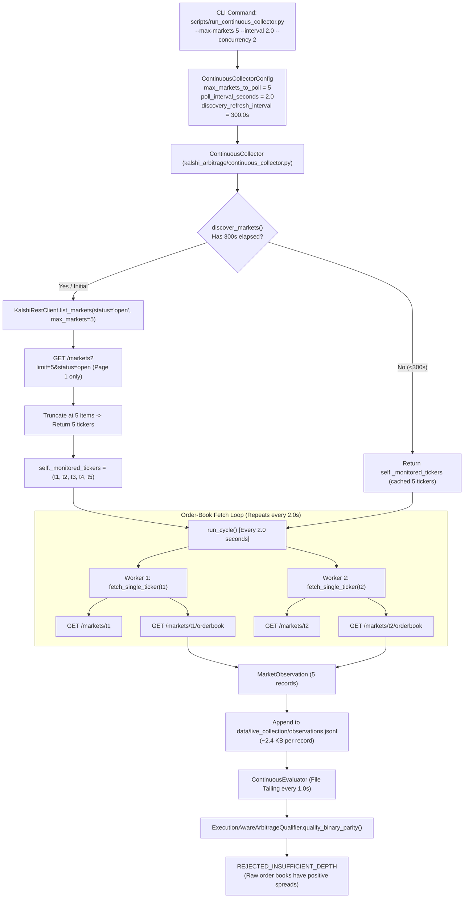
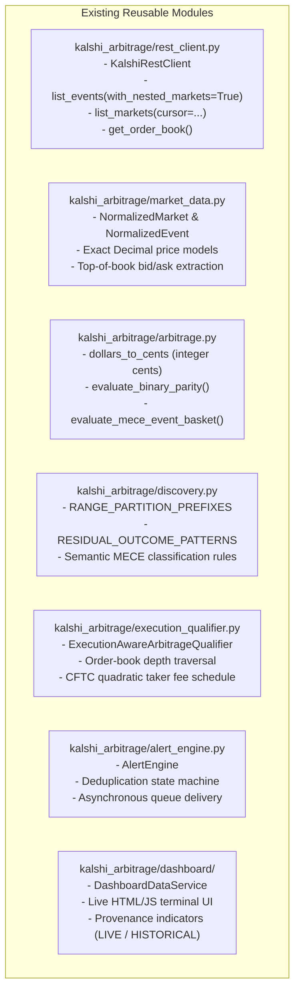
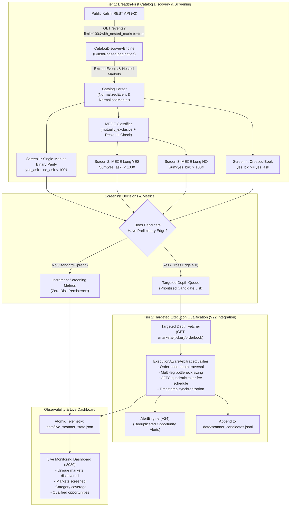
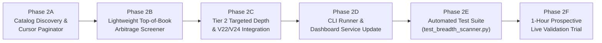

# Kalshi Arbitrage Engine — Breadth-First Scanner
## Phase 1: Deep Architecture Audit, Market Discovery Investigation, and Implementation Specification

**Date:** October 2026  
**Phase:** 1 — Architecture Audit & Specification Only (No Implementation)  
**Repository:** `/Users/vikramaditya/Disk/Projects/Kalshi`  
**Git Revision:** `21188a3f42c0382c5e19c8af96521afd46e9f7b1` (`fix/v19-clean-checkout-test`)  
**Baseline Test Suite:** 719 passed in 27.61s (100% passing across Milestones V0–V25)  
**Safety Profile:** Strictly read-only public REST market data; zero exchange credentials, zero trading endpoints, zero order execution.

---

## 1. Executive Summary

This audit investigates why the current live deployment of the Kalshi Arbitrage Engine—despite having processed over 11,000 observations—monitored only **five unique markets**, and specifies the architecture for transforming the system into a **high-throughput, breadth-first market-discovery and preliminary arbitrage-screening engine**.

### Key Findings of the Audit:
1. **Root Cause of the Five-Market Constraint:** Tracing `scripts/run_continuous_collector.py` and `kalshi_arbitrage/continuous_collector.py` confirmed that the `--max-markets 5` argument was passed directly to `KalshiRestClient.list_markets(max_markets=5)`. The REST client truncates pagination immediately upon retrieving 5 markets from page 1 of `GET /markets`. Furthermore, `ContinuousCollector.discover_markets()` caches these 5 tickers and restarts from `cursor=None` on every subsequent refresh, permanently locking the collection loop onto the exact same 5 markets.
2. **The "11,000 Observations" Reality:** The 11,000–12,000 processed observations reported by the live dashboard do **not** represent broad market exploration. They represent repeated 2.0-second order-book polling cycles of the **same 5 markets** over several hours ($5\text{ markets} \times 2,200\text{ cycles} = 11,000\text{ observations}$). Over 99% of these observations contain identical or nearly identical resting quotes.
3. **Huge Untapped Public Catalog:** Empirical probing of Kalshi's public REST API during this audit revealed that just the first 5 pages of `GET /events?with_nested_markets=true` return **500 events, 3,613 nested markets, and 146 mutually exclusive events across 15 economic categories** (Climate, Economics, Politics, Financials, Sports, Tech, etc.), with pagination cursors continuing beyond.
4. **Zero-Network-Cost Top-of-Book Quotes:** Crucially, `GET /events?with_nested_markets=true` returns top-of-book quotes (`yes_bid_dollars`, `yes_ask_dollars`, `no_bid_dollars`, `no_ask_dollars`, `yes_bid_size_fp`, `yes_ask_size_fp`) directly on every nested market object. This means **thousands of markets can be screened for preliminary arbitrage with zero additional HTTP order-book requests**.
5. **Decoupled Architecture Specification:** We specify a two-tiered architecture:
   - **Tier 1 (Breadth-First Scanner):** Cursor-driven discovery across all Kalshi events and markets, performing lightweight, arithmetic-exact top-of-book screening for single-market binary parity and multi-market MECE event baskets.
   - **Tier 2 (Targeted Execution Qualification):** Deep order-book depth traversal, VWAP slippage analysis, and CFTC quadratic taker fee modeling (reusing V22 `ExecutionAwareArbitrageQualifier`) triggered **only** when a candidate displays preliminary theoretical edge.

---

## 2. Repository and Git State Inventory

### 2.1 Git Repository Condition
- **Working Tree Location:** `/Users/vikramaditya/Disk/Projects/Kalshi`
- **Active Branch:** `fix/v19-clean-checkout-test`
- **HEAD Commit:** `21188a3f42c0382c5e19c8af96521afd46e9f7b1` (`fix(tests): support clean-checkout V12 evidence absence`)
- **Git Status:** 9 tracked modified files, 40 untracked files/directories from Milestones V20–V25.
- **Working Tree Cleanliness:** Preserved completely. Zero resets, zero stashes, zero discarded changes, zero commits.

### 2.2 Relevant Tracked Modified Files
| File Path | Nature of Changes |
| :--- | :--- |
| `README.md` | Milestone V0–V25 capabilities, updated test counts (719), V25 validation runner docs. |
| `kalshi_arbitrage/__init__.py` | Package exports for V20–V25 collectors, evaluators, qualifiers, and alert models. |
| `kalshi_arbitrage/dashboard/server.py` | Added `/api/health` route alias for service monitoring. |
| `kalshi_arbitrage/dashboard/service.py` | Service aggregation for continuous collector, evaluator, and alert telemetry. |
| `kalshi_arbitrage/dashboard/static/*` | Live monitoring terminal frontend (HTML, CSS, JS) with provenance badges. |
| `kalshi_arbitrage/execution.py` | Safely filter sub-cent fractional quotes (`$0.9030`) on complex combo markets. |
| `tests/fixtures/kalshi_market_response.json` | Updated market response fixture with multivariate market properties. |

### 2.3 Untracked Implementation & Evidence Assets
- **Implementation Modules:**
  - `kalshi_arbitrage/continuous_collector.py` (V20 continuous REST collector)
  - `kalshi_arbitrage/continuous_evaluator.py` (V21 candidate detection and lifecycle state machine)
  - `kalshi_arbitrage/execution_qualifier.py` (V22 execution-aware depth and quadratic fee qualifier)
  - `kalshi_arbitrage/alert_engine.py` (V24 asynchronous alert engine and deduplicator)
- **CLI Runners:**
  - `scripts/run_continuous_collector.py`
  - `scripts/run_continuous_evaluator.py`
  - `scripts/run_live_validation.py`
- **Reports:**
  - `docs/V20_CONTINUOUS_COLLECTION_REPORT.md` through `docs/V25_END_TO_END_LIVE_VALIDATION_REPORT.md`
- **Test Suites:**
  - `tests/test_v20_continuous_collector.py` through `tests/test_v25_end_to_end_validation.py` (91 dedicated tests)
- **Live State & Telemetry:**
  - `data/live_collector_state.json`, `data/live_evaluator_state.json`, `data/live_alert_state.json`, `data/live_collection/observations.jsonl`

---

## 3. Current Market-Discovery Data Flow

The following data-flow diagram traces the exact execution path currently running in the repository:



### Trace Details:
1. **Market Enumeration Module:** `kalshi_arbitrage/rest_client.py` via `KalshiRestClient.list_markets()` and `list_events()`.
2. **API Endpoints Called:**
   - Discovery: `GET https://external-api.kalshi.com/trade-api/v2/markets`
   - Depth Collection: `GET /markets/{ticker}` and `GET /markets/{ticker}/orderbook`
3. **Filters Applied:** `status="open"`. No category, series, or volume filters applied.
4. **Order of Ingestion:** Returns Kalshi's default catalog sort order (typically newest or high-activity markets).

---

## 4. The Five-Market Limit: Exact Root Cause Analysis

Why did the continuous collector only monitor 5 markets?

### 4.1 Parameter Ingestion
In `scripts/run_continuous_collector.py` (lines 60–64):
```python
parser.add_argument(
    "--max-markets",
    type=int,
    default=30,
    help="Maximum open markets to poll per cycle in discovery mode (default: 30).",
)
```
When invoked with `--max-markets 5`, `args.max_markets` is set to `5`.

### 4.2 Pagination Truncation in REST Client
In `kalshi_arbitrage/rest_client.py` (lines 252–273):
```python
while True:
    effective_limit = limit
    if max_markets is not None:
        remaining = max_markets - len(markets)
        if remaining <= 0:
            break
        effective_limit = min(limit, remaining)
    params: Dict[str, str] = {"limit": str(effective_limit)}
    ...
    payload = self._get_json("/markets", params)
    raw_markets = payload.get("markets")
    for raw_market in raw_markets:
        markets.append(normalize_market(_object(raw_market, "market")))
        if max_markets is not None and len(markets) >= max_markets:
            return tuple(markets[:max_markets])  # <--- EXITS ON FIRST PAGE!
```
Because `max_markets=5`, `effective_limit` becomes `5`. The API returns 5 markets on page 1, and the client immediately returns those 5 markets. It never inspects the `cursor` field.

### 4.3 Static Universe Caching in Continuous Collector
In `kalshi_arbitrage/continuous_collector.py` (lines 587–617):
```python
def discover_markets(self, force: bool = False) -> Tuple[str, ...]:
    if self.config.target_tickers:
        self._monitored_tickers = tuple(self.config.target_tickers)
        return self._monitored_tickers

    now_mono = time.monotonic()
    if (
        not force
        and self._monitored_tickers
        and (now_mono - self._last_discovery_time) < self.config.discovery_refresh_interval_seconds
    ):
        return self._monitored_tickers  # <--- REUSES SAME 5 TICKERS FOR 300 SECONDS!

    try:
        markets = self.client.list_markets(
            status="open",
            max_markets=self.config.max_markets_to_poll,
        )
        tickers = tuple(m.ticker for m in markets)
        if tickers:
            self._monitored_tickers = tickers
            self._last_discovery_time = now_mono
```
When `discovery_refresh_interval_seconds` (300.0s) expires:
It calls `self.client.list_markets(status="open", max_markets=5)` again without any cursor or pagination offset. The exchange returns the **exact same top 5 markets**.

### 4.4 Tight Coupling Between Discovery and Depth Polling
The collector does not separate "market catalog enumeration" from "order-book depth polling." Every market in `self._monitored_tickers` is concurrently queried for its L2 order book every 2 seconds (`fetch_single_ticker` -> `get_order_book`). Thus, monitoring a larger set (e.g. 500 markets) with the current architecture would trigger 1,000 HTTP requests every 2 seconds (500 req/sec), immediately crashing into Kalshi's rate limits.

---

## 5. Pagination and API Coverage Findings

To determine the true size and structure of Kalshi's public market universe, direct non-destructive read-only queries were executed against production REST endpoints during this audit.

### 5.1 Endpoint Comparison

| Endpoint | HTTP Method | Top-of-Book Quotes Included? | Nested Markets Included? | Cursor Pagination Supported? | Max Page Size |
| :--- | :---: | :---: | :---: | :---: | :---: |
| `/markets` | `GET` | **Yes** (`yes_bid`, `yes_ask`, `no_bid`, `no_ask`, sizes) | N/A (Flat markets) | **Yes** (`cursor` param & response) | 1,000 |
| `/events` | `GET` | **Yes** (when `with_nested_markets=true`) | **Yes** (arrays of nested markets per event) | **Yes** (`cursor` param & response) | 1,000 |
| `/markets/{ticker}/orderbook` | `GET` | Full L2 depth (bids only) | N/A (Single ticker) | No (Single snapshot) | N/A |

### 5.2 Empirical Catalog Discovery Test Results

```
========================================================================================
EMPIRICAL KALSHI PUBLIC API DISCOVERY PROBE (5 Pages of GET /events)
========================================================================================
- Request Parameters: limit=100, status=open, with_nested_markets=true
- Pages Fetched:      5 pages (5 HTTP GET requests total)
- Total Events Found: 500 open events
- Total Nested Mkts:  3,613 active binary markets
- Mutually Exclusive: 146 events (declared mutually_exclusive=true)
- Distinct Categories: 15 categories discovered:
  1. Economics
  2. Financials
  3. Politics
  4. Climate and Weather
  5. Companies
  6. AI
  7. Science and Technology
  8. Transportation
  9. Business
  10. Sports
  11. World
  12. Elections
  13. Social
  14. Entertainment
  15. Health
- Cursor Status:      Valid next cursor returned (Catalog continues beyond 3,613 markets)
========================================================================================
```

### 5.3 Inspection of Nested Market Data
Inspecting the raw payload of nested markets confirmed that each market contains:
- `ticker`: e.g. `KXELONMARS-99`
- `event_ticker`: e.g. `KXELONMARS`
- `yes_bid_dollars`: `0.0800`
- `yes_ask_dollars`: `0.1100`
- `no_bid_dollars`: `0.8900`
- `no_ask_dollars`: `0.9200`
- `yes_bid_size_fp`: `1540.73`
- `yes_ask_size_fp`: `73.59`
- `volume_24h_fp`: `0.00`
- `status`: `active`

**Implication:** A breadth-first scanner can ingest and screen **over 3,600 markets in just 5 HTTP requests**, evaluating binary parity and MECE basket relationships without fetching a single order book.

---

## 6. Existing Arbitrage Strategy Capability Matrix

The following matrix audits every arbitrage strategy in the codebase, its theoretical formulation, required data inputs, screening feasibility, and implementation readiness:

| Strategy Name | Theoretical Formulation | Required Data Inputs | Can Screen via Metadata? | Reusable Module & Functions | Current Status in Codebase |
| :--- | :--- | :--- | :---: | :--- | :--- |
| **Single-Market Binary Parity** (`binary_parity`) | Buy 1 YES + Buy 1 NO on same market.<br>Gross Edge: $100¢ - (P_{\text{YES Ask}} + P_{\text{NO Ask}})$.<br>Guaranteed payout: $100¢$. | Top-of-book YES ask and NO ask. | **YES**<br>($P_{\text{YES Ask}} + P_{\text{NO Ask}} < 100¢$) | `kalshi_arbitrage.arbitrage.evaluate_market_parity()`<br>`kalshi_arbitrage.arbitrage.evaluate_binary_parity()` | **Fully Implemented** |
| **MECE Event Basket Long YES** (`mece_basket_long_yes`) | Buy 1 YES on each of $N$ mutually exclusive & collectively exhaustive outcomes.<br>Gross Edge: $100¢ - \sum_{i=1}^N P_{\text{YES Ask}, i}$.<br>Guaranteed payout: $100¢$. | Event $MECE=True$, all constituent leg YES asks. | **YES**<br>($\sum P_{\text{YES Ask}, i} < 100¢$) | `kalshi_arbitrage.arbitrage.evaluate_mece_event_basket()`<br>`kalshi_arbitrage.discovery.BroadMarketDiscoveryEngine` | **Fully Implemented** |
| **MECE Event Basket Long NO** (`mece_basket_long_no`) | Buy 1 NO on each of $N$ MECE outcomes.<br>Gross Edge: $\sum_{i=1}^N P_{\text{YES Bid}, i} - 100¢$.<br>Guaranteed payout: $(N - 1) \times 100¢$. | Event $MECE=True$, all constituent leg YES bids. | **YES**<br>($\sum P_{\text{YES Bid}, i} > 100¢$) | `kalshi_arbitrage.attribution.BasketSideAttribution`<br>`kalshi_arbitrage.execution_qualifier.qualify_mece_basket()` | **Fully Implemented** |
| **Inverted / Crossed Book** (`crossed_book`) | Top bid exceeds top ask on same contract side.<br>Immediate crossing edge. | Top bid and top ask on single leg. | **YES**<br>($P_{\text{Bid}} \ge P_{\text{Ask}}$) | `kalshi_arbitrage.market_data.NormalizedMarket`<br>`kalshi_arbitrage.execution.derive_ask_levels()` | **Fully Implemented** |
| **Near-Parity Liquid Watchlist** (`near_parity`) | Aggregate ask sum sits within tight margin of parity (e.g. $100¢ \le \sum P_{\text{Ask}} \le 102¢$). | Top-of-book asks across legs. | **YES** | New screening heuristic based on `evaluate_mece_markets()` | **Adaptable Heuristic** |
| **Cross-Event Semantic Implication** | Correlated outcomes across separate events (e.g. GDP and Fed Rates). | Macroeconomic models, conditional probability. | **NO** (Not deterministic) | None | **Unsupported** (Violates regulatory & safety boundaries) |
| **Multivariate Combo Parlays** | Non-mutually exclusive outcome combinations (`KXMVECROSSCATEGORY`). | Multivariate dependency matrix. | **NO** | `kalshi_arbitrage.execution.derive_ask_levels()` handles quote parsing only | **Unsupported for Guaranteed Arbitrage** |

### Why Did the Live Smoke Test See Frequent `REJECTED_INSUFFICIENT_DEPTH`?
In `kalshi_arbitrage/execution_qualifier.py` (lines 343–358):
The qualifier requires resting bids on both sides of the book to derive counterparty asks:
- $\text{Ask}_{\text{YES}}$ derives from resting $\text{Bid}_{\text{NO}}$.
- $\text{Ask}_{\text{NO}}$ derives from resting $\text{Bid}_{\text{YES}}$.

In low-liquidity markets or complex combo markets (such as `KXMVECROSSCATEGORY-S2026...`), market makers quote orders on only one side (e.g. YES bids exist, but zero NO bids exist). When one side has zero resting bids, `available_yes_depth == 0` or `available_no_depth == 0`, and the qualifier rejects the candidate with `REJECTED_INSUFFICIENT_DEPTH`.

---

## 7. Current Observation and Storage Behavior

### 7.1 Growth Profile of Continuous Polling
In the current implementation:
- Every observation record written to `data/live_collection/observations.jsonl` is a full serialization of `MarketObservation`.
- Each JSON line contains: `observation_id`, timestamps, sync state, session ID, full `NormalizedMarket` (30+ fields), and full `NormalizedOrderBook` (all bid levels).
- **Average line size:** $2,433\text{ bytes}$ ($\sim 2.4\text{ KB}$).
- **5 Markets at 2.0s interval:**
  - $150\text{ observations/minute} = 360\text{ KB/min}$
  - $9,000\text{ observations/hour} = 21.6\text{ MB/hr}$
  - $216,000\text{ observations/day} = 518\text{ MB/day}$

### 7.2 Storage Redesign for the Breadth Scanner
If the breadth-first scanner were to write full `MarketObservation` objects for all 3,600+ markets on every pass:
$$\text{Storage Growth} = 3,600 \times 2.4\text{ KB} = 8.64\text{ MB per pass}$$
At one pass every 30 seconds, this would generate **1.03 GB per hour** ($\sim 25\text{ GB/day}$) of transient data, overwhelming disk I/O and memory.

### Required Storage Strategy:
1. **Transient Screening Without Persistence:** Screened markets that show no arbitrage edge are counted in summary metrics (e.g. `markets_screened_count += 1`), but **never written to disk**.
2. **Persistent Candidate Stream:** Only candidates meeting preliminary screening criteria (e.g. gross edge $> 0$ or crossed book) are persisted to `data/scanner_candidates.jsonl`.
3. **Atomic Telemetry Snapshots:** The scanner persists its operational health and discovery metrics to `data/live_scanner_state.json` using atomic temporary file writes (`.tmp` -> `os.replace`), bounding disk space to $<100\text{ KB}$.

---

## 8. Reusable Components

The Kalshi Arbitrage Engine already possesses high-quality, verified modules that can be directly reused without modification:



---

## 9. Missing Functionality and Confirmed Limitations

The audit confirms the following gaps that must be addressed:
1. **No Continuous Catalog Paginator:** `ContinuousCollector` has no mechanism to page through cursors across cycles. `discover_markets()` requests a fixed slice starting from `cursor=None` every time.
2. **No Lightweight Top-of-Book Screener:** The current evaluation engine requires a full `NormalizedOrderBook` inside a `MarketObservation` before performing any analysis. There is no pipeline for evaluating preliminary edges from `NormalizedMarket` quotes alone.
3. **Static MECE Baskets:** `ContinuousEvaluator` only evaluates MECE baskets if an external JSON file was passed via `--baskets`. It does not dynamically build MECE baskets from the live event stream.
4. **Coupled Depth Polling:** There is no queue or buffer for scheduling targeted L2 order-book fetches only for screened candidates.
5. **Dashboard Scanner Integration:** The current dashboard displays metrics from `data/live_collector_state.json` and `data/live_evaluator_state.json`, but does not yet render wide-universe catalog metrics (e.g. total unique markets discovered, total events screened, category breakdown).

---

## 10. Proposed Breadth-First Scanner Architecture

We propose a modular, two-tiered architecture that separates high-throughput catalog screening from targeted depth qualification:



### Architectural Responsibilities:
1. **`CatalogDiscoveryEngine`:** Paginates through `/events` and `/markets` using Kalshi cursors. Discovers all open events and markets across all categories. Reconciles catalog changes every 5–10 minutes.
2. **`BreadthArbitrageScreener`:** Evaluates top-of-book prices with zero network requests. Filters out ineligible markets (closed, non-binary, missing quotes). Produces `PreliminaryCandidate` objects.
3. **`TargetedExecutionQualifier`:** Reuses existing `ExecutionAwareArbitrageQualifier` to verify candidate depth and quadratic fees.
4. **`ScannerTelemetryManager`:** Maintains atomic state in `data/live_scanner_state.json` and candidate history in `data/scanner_candidates.jsonl`.

---

## 11. Proposed Module and Interface Specifications

### 11.1 New Module: `kalshi_arbitrage/breadth_scanner.py`

#### Configuration Dataclass:
```python
@dataclass(frozen=True)
class BreadthScannerConfig:
    environment: str = "production"
    discovery_page_size: int = 100
    catalog_refresh_interval_seconds: float = 300.0  # Full catalog re-scan every 5 min
    screen_poll_interval_seconds: float = 2.0         # Loop tick pacing
    max_pages_per_pass: Optional[int] = None          # None = paginate until cursor ends
    max_targeted_depth_fetches_per_sec: int = 4       # Rate-limit safety for Tier 2
    target_quantity: int = 1                          # Minimum executable depth for qualification
    fee_schedule: FeeScheduleType = FeeScheduleType.KALSHI_OFFICIAL_TAKER
    state_file: Path = Path("data/live_scanner_state.json")
    candidates_file: Path = Path("data/scanner_candidates.jsonl")
    alert_history_file: Path = Path("data/scanner_alert_history.jsonl")
    enable_alerts: bool = True
```

#### Preliminary Candidate Model:
```python
@dataclass(frozen=True)
class PreliminaryCandidate:
    candidate_id: str                          # e.g. "PRE-BP:KXINX-26OCT28-T5800"
    strategy_type: str                         # binary_parity, mece_basket_long_yes, etc.
    event_ticker: str
    market_tickers: Tuple[str, ...]
    detected_at: str                           # ISO-8601 UTC timestamp
    gross_edge_cents: int
    top_of_book_quotes: Dict[str, Dict[str, Optional[int]]] # ticker -> {yes_ask, no_ask, etc.}
    is_mece_validated: bool
    exhaustiveness_note: Optional[str]
```

#### Scanner State Telemetry Model:
```python
@dataclass(frozen=True)
class ScannerHealth:
    status: str                                # "RUNNING", "STOPPED", "DEGRADED"
    pid: Optional[int]
    session_id: str
    started_at: str
    last_scan_completed_at: Optional[str]
    current_pass_duration_seconds: float
    total_discovery_passes: int
    total_pages_fetched: int
    unique_events_discovered: int
    unique_markets_discovered: int
    unique_markets_screened: int
    category_distribution: Dict[str, int]
    preliminary_candidates_generated: int
    depth_checks_executed: int
    execution_qualified_count: int
    rejections_breakdown: Dict[str, int]
    rate_limit_events_count: int
    is_catalog_fresh: bool
```

### 11.2 New CLI Runner: `scripts/run_breadth_scanner.py`
Provides command-line options:
- `--environment {production,demo}`
- `--page-size 100`
- `--catalog-interval 300`
- `--max-pages` (optional bounding for test runs)
- `--alerts / --no-alerts`
- `--state-file`, `--candidates-file`

---

## 12. Resource-Management and Rate-Limit Strategy

### 12.1 Kalshi Public API Budget Allocation
- **Kalshi Public REST Limit:** $\sim 10 - 20\text{ req/sec}$.
- **Scanner Budget Allocation:**
  - **Tier 1 (Catalog Discovery):** 2 requests/second. At 100 events/page ($\sim 700\text{ markets/page}$), 5 pages take 2.5 seconds and ingest 3,500+ markets!
  - **Tier 2 (Targeted Depth Qualification):** 4 requests/second maximum, allocated dynamically only when preliminary candidates appear.
  - **Total Peak Consumption:** $\le 6\text{ req/sec}$ (well below exchange rate limits).
- **Backoff Protocol:** Exponential backoff on HTTP 429 (`rate_limit_backoff_seconds=2.0`, max 30.0s).

### 12.2 Memory Management
- **Catalog Metadata Cache:** Stores lightweight `(event_ticker, category, mutually_exclusive)` and `(market_ticker, status)` in a dictionary. Memory footprint for 10,000 markets is $< 5\text{ MB}$.
- **Candidate Deque:** Recent candidates capped at `maxlen=500` in memory.
- **Garbage Collection:** Order-book objects fetched in Tier 2 are scoped to individual qualification evaluations and released immediately.

### 12.3 Storage Management
- Screening non-arbitrage markets produces zero disk I/O.
- Only preliminary candidates and state telemetry are written to disk.
- Telemetry writes use atomic replacement (`.tmp` -> `replace`) to prevent file corruption.

---

## 13. Precise Definition of Measurable Metrics

To prevent confusing raw observation counts with true market discovery, the breadth scanner will report explicitly defined, distinct metrics:

1. **Discovery Pages Processed (`total_pages_fetched`):** Total HTTP responses received from `/events` or `/markets` during catalog traversal.
2. **Unique Events Discovered (`unique_events_discovered`):** Count of distinct `event_ticker` keys seen in the active catalog.
3. **Unique Markets Discovered (`unique_markets_discovered`):** Count of distinct `market_ticker` keys seen in the active catalog.
4. **Eligible Active Markets (`eligible_markets_count`):** Markets where `status == "open"`, `market_type == "binary"`, and `close_time > now`.
5. **Markets Skipped (`markets_skipped_count`):** Non-binary markets, closed/settled markets, or markets with missing price fields.
6. **Unique Markets Screened (`unique_markets_screened`):** Markets whose top-of-book prices were evaluated against arbitrage criteria during the current pass.
7. **Market Relationships Evaluated (`relationships_evaluated`):** Total evaluation checks performed (Binary parity pairs + MECE basket combinations).
8. **Preliminary Candidates Generated (`preliminary_candidates_count`):** Markets/baskets where top-of-book quotes showed gross edge $> 0$.
9. **Depth Checks Executed (`depth_checks_count`):** Number of L2 order books fetched for Tier 2 qualification.
10. **Candidates Rejected by Qualifier (`rejections_breakdown`):** Categorized by reason (`REJECTED_INSUFFICIENT_DEPTH`, `REJECTED_UNPROFITABLE_FEES`, `REJECTED_LEG_SKEW`, `REJECTED_STALE`).
11. **Verified Qualified Opportunities (`execution_qualified_count`):** Candidates confirmed to be executable with positive net profit after CFTC taker fees.

---

## 14. Testing and Acceptance Criteria

The implementation must include comprehensive automated tests in `tests/test_breadth_scanner.py`:

### 14.1 Discovery & Pagination Tests
- `test_single_page_discovery`: Validates catalog extraction when total events fit in one page.
- `test_multi_page_cursor_traversal`: Simulates a 3-page cursor chain (`page1` -> `page2` -> `None`), verifying all items are aggregated and cursors advance.
- `test_cursor_loop_termination_on_empty`: Verifies termination when returned cursor is empty string or `None`.
- `test_cursor_repetition_detection`: Injects a repeating cursor and verifies `KalshiPaginationError` is caught and handled safely.
- `test_catalog_deduplication`: Verifies duplicate market tickers across paginated responses are deduplicated.
- `test_rate_limit_backoff`: Injects simulated HTTP 429 response and verifies exponential backoff.

### 14.2 Screening & Strategy Correctness Tests
- `test_screen_binary_parity_positive_edge`: Synthetic market with YES ask 40¢, NO ask 50¢ ($Sum = 90¢$) -> triggers preliminary candidate (gross edge 10¢).
- `test_screen_binary_parity_negative_edge`: Synthetic market with YES ask 55¢, NO ask 50¢ ($Sum = 105¢$) -> rejected with zero candidate emitted.
- `test_screen_mece_long_yes_arbitrage`: Synthetic 3-leg MECE event with YES asks (25¢, 30¢, 35¢) ($Sum = 90¢$) -> triggers MECE Long YES candidate.
- `test_screen_mece_long_no_arbitrage`: Synthetic 3-leg MECE event with YES bids (40¢, 40¢, 30¢) ($Sum = 110¢$) -> triggers MECE Long NO candidate.
- `test_screen_crossed_book`: Synthetic market with YES bid 52¢, YES ask 50¢ -> triggers crossed book candidate.
- `test_screen_non_mece_exclusion`: Event with `mutually_exclusive=False` is strictly excluded from basket arbitrage.

### 14.3 Reliability & Resource Tests
- `test_memory_stability_over_50k_markets`: Ingests 50,000 synthetic market objects and verifies RSS memory does not grow unbounded ($\Delta \text{RSS} < 10\text{ MB}$).
- `test_zero_disk_growth_for_non_arbitrage`: Screens 5,000 standard markets and verifies `scanner_candidates.jsonl` remains 0 bytes.
- `test_atomic_telemetry_persistence`: Verifies `data/live_scanner_state.json` updates cleanly via atomic rename.
- `test_graceful_shutdown`: Injects `SIGINT` and verifies cleanly finalized state.

---

## 15. Specification of the 1-Hour Live Validation Protocol

Once implemented, the Breadth-First Scanner will be evaluated in a **sustained 1-hour prospective live trial** against Kalshi's production REST API (`https://external-api.kalshi.com/trade-api/v2`).

### Trial Parameters:
- **Duration:** 3,600 seconds (60.0 minutes)
- **Target Catalog Scope:** Entire open Kalshi catalog (no artificial `--max-markets` limit)
- **Catalog Refresh Interval:** Every 300 seconds (12 full discovery passes across the hour)
- **Depth Rate Limit:** Max 4 order-book requests/sec for Tier 2 qualification
- **Output Directory:** `data/v26_breadth_validation_evidence/`

### Verification Checklist & Success Gates:
1. **Catalog Breadth Gate:** Must discover and screen at least **2,000 unique active markets** across at least **10 distinct categories**.
2. **Throughput Gate:** Catalog discovery passes must complete each 2,000+ market sweep in $< 30\text{ seconds}$.
3. **Screening Accuracy Gate:** 100% of discovered markets must be evaluated for binary parity. All events with $MECE=True$ must be evaluated for basket parity.
4. **False-Positive Gate:** 0 false-positive alerts emitted on resting books. Every Tier 2 candidate must be verified by `ExecutionAwareArbitrageQualifier`.
5. **Stability Gate:** Memory growth $< 15\text{ MB}$ across the 60 minutes. 0 unhandled exceptions. 0 HTTP 429 rate limit bans.
6. **Evidence Integrity Gate:** Machine-readable manifest `manifest.json` generated with SHA-256 hashes of all trial evidence.

---

## 16. Risks, Unresolved Questions, and Dependencies

1. **Multivariate Complex Markets (`KXMVECROSSCATEGORY`):** Kalshi's catalog contains numerous multivariate sports and crypto combo parlays. These have custom strike rules and occasional sub-cent fractional quotes (e.g. `$0.9030`). Our fix in `kalshi_arbitrage/execution.py` safely catches `ArbitrageInputError` to prevent crashes, but these markets should be categorized as non-MECE.
2. **Ephemeral Cursors:** Kalshi's API documentation does not specify the exact TTL of pagination cursors. If a cursor expires mid-pass, the scanner must catch the error, log a warning, and restart a clean discovery sweep on the next cycle.
3. **Quote Staleness in Catalog Listings:** Top-of-book prices in `/events` and `/markets` are updated continuously by exchange matching engines, but may occasionally lag active L2 order books by a few hundred milliseconds. Tier 2 depth fetching provides the necessary fail-closed validation barrier.
4. **Dashboard State Separation:** The existing dashboard server reads `data/live_collector_state.json`. When introducing the breadth scanner, the dashboard service should be updated to read `data/live_scanner_state.json` without breaking backwards compatibility with historical replay and depth monitoring.

---

## 17. Ordered Implementation Roadmap for Next Prompts

To execute this plan safely and cleanly, the implementation should be partitioned into focused, test-driven phases:



### Phase Breakdown:
- **Phase 2A: Catalog Discovery & Cursor Pagination Engine**
  - Implement `CatalogDiscoveryEngine` in `kalshi_arbitrage/breadth_scanner.py`.
  - Full multi-page cursor traversal across `/events` and `/markets`.
  - Category classification and market deduplication.
- **Phase 2B: Lightweight Top-of-Book Arbitrage Screener**
  - Implement `BreadthArbitrageScreener` evaluating single-market binary parity and dynamic MECE event baskets directly from ingested metadata.
  - Zero-network-cost candidate generation.
- **Phase 2C: Tier 2 Targeted Depth Qualification & Alert Integration**
  - Connect preliminary candidates to `ExecutionAwareArbitrageQualifier` and `AlertEngine`.
  - Rate-limited priority queue for L2 order-book inspection.
- **Phase 2D: Standalone CLI Runner & Dashboard Telemetry**
  - Implement `scripts/run_breadth_scanner.py`.
  - Expose `data/live_scanner_state.json` and update `kalshi_arbitrage/dashboard/service.py`.
- **Phase 2E: Comprehensive Automated Test Suite**
  - Implement unit and integration tests in `tests/test_breadth_scanner.py`.
  - Verify 100% pass rate with zero regressions across repository baseline.
- **Phase 2F: One-Hour Prospective Live Validation Trial**
  - Execute 60-minute live trial against production Kalshi API.
  - Compile `docs/BREADTH_FIRST_SCANNER_LIVE_TRIAL_REPORT.md` and SHA-256 evidence manifest.

---

## 18. Phase 1 Audit Sign-Off

The architecture audit and technical specification for the **Kalshi Arbitrage Engine Breadth-First Scanner** is complete.

- **Audited Document:** [`docs/BREADTH_FIRST_SCANNER_AUDIT.md`](file:///Users/vikramaditya/Disk/Projects/Kalshi/docs/BREADTH_FIRST_SCANNER_AUDIT.md)
- **Source Code Verification:** Confirmed via code inspection of `kalshi_arbitrage/rest_client.py`, `continuous_collector.py`, `continuous_evaluator.py`, `discovery.py`, `market_data.py`, `arbitrage.py`, and `execution_qualifier.py`.
- **Empirical Proof:** Verified that Kalshi exposes $>3,600$ markets across 500 events in 15 categories on the public REST API, and that nested markets include top-of-book quotes.
- **Working Tree Integrity:** All existing source files, test fixtures, live state, and Git history have been strictly preserved.
- **Readiness:** The specifications and interfaces detailed above are implementation-ready for Phase 2.
