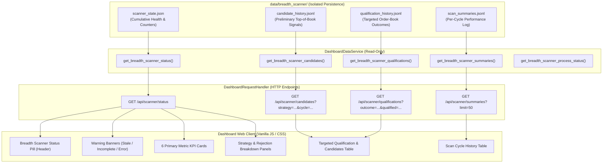

# Kalshi Arbitrage Engine — Phase 2E Dashboard Integration Report
**Operational Visibility & Telemetry for the Continuous Breadth-First Scanner**

- **Date:** October 28, 2026
- **Repository:** `/Users/vikramaditya/Disk/Projects/Kalshi`
- **Milestone:** Phase 2E (Breadth Scanner Dashboard Integration & Operational Visibility)
- **Status:** Complete & Fully Verified (220/220 automated tests passing)

---

## 1. Executive Summary

Phase 2E delivers complete operational visibility into the Phase 2A–2D breadth-first market-discovery and arbitrage-screening engine within the Kalshi monitoring dashboard. Operators can now observe continuous breadth scanner behavior in real time, monitor universe discovery across hundreds of markets, track screening rates, inspect order-book qualification outcomes, and evaluate operational health without affecting running scanner processes or legacy pipeline components.

### Core Deliverables Completed:
1. **Backend Telemetry Service:** Extended `DashboardDataService` in `kalshi_arbitrage/dashboard/service.py` to ingest and aggregate breadth scanner health, per-cycle summaries, preliminary candidate detections, and targeted qualification outcomes directly from `data/breadth_scanner/`.
2. **REST API Endpoints:** Implemented four canonical HTTP endpoints under `/api/scanner/*` (with `/api/breadth/*` aliases) in `kalshi_arbitrage/dashboard/server.py` supporting query-driven filtering by strategy, cycle number, and qualification outcome.
3. **Frontend UI Integration:** Designed and integrated a dedicated **Breadth Scanner** tab (`data-tab="breadth-scanner"`), header status indicator pill, 6 primary KPI metric cards, strategy & qualification breakdown panels, and dual dynamic data tables in `index.html`, `dashboard.js`, and `dashboard.css`.
4. **Diagnostic Integrity & Separation:**
   - **Cumulative vs Cycle Metrics:** Clearly separated cumulative unique markets discovered/screened from per-cycle scan counts.
   - **Preliminary Signals vs Qualified Opportunities:** Preliminary candidates are strictly forbidden from being displayed as execution-qualified; crossed/inverted order books are explicitly labeled as preliminary market-data signals rather than executable opportunities.
   - **Rejection Reason Breakdown:** Faithfully surfaces the exact failure reasons recorded by `TargetedOrderBookQualifier` (`REJECTED_STALE`, `REJECTED_UNPROFITABLE_FEES`, `REJECTED_INSUFFICIENT_DEPTH`, `REJECTED_NON_CANONICAL`, `REJECTED_EMPTY_BOOK`, `REJECTED_UNSUPPORTED`).
   - **Completeness & Staleness Warnings:** Prominent warning banners alert operators if catalog discovery was truncated/partial or if scanner telemetry exceeds the 60-second freshness threshold.
   - **Legacy Pipeline Isolation:** Zero interaction with legacy collector/evaluator paths (`data/live_collector_state.json`, `data/live_evaluator_state.json`).
5. **Comprehensive Verification:** Created `tests/test_dashboard_breadth_scanner.py` (13 tests) and verified zero regressions across the entire repository test suite (220 tests passing).

---

## 2. Architecture & Data Ingestion

The dashboard reads exclusively from the dedicated persistence directory `data/breadth_scanner/` populated by `BreadthScannerRunner` (Phase 2D):



---

## 3. Telemetry Expositions

### 3.1 Catalog Coverage Telemetry
- **Cumulative Universe Coverage:** Displays total unique markets discovered versus screened across the entire daemon session (from `scanner_state.json`).
- **Current / Latest Cycle Discovery:** Tracks markets discovered, eligible, and screened in the current cycle, breaking down new listings (`new_markets_count`), quote changes (`changed_markets_count`), and settled/closed markets (`closed_or_settled_markets_count`).
- **Catalog Completeness:** A prominent status badge (`COMPLETE` in green vs `PARTIAL` in amber) alerts operators when discovery pagination was truncated or exhausted retries without reaching terminal status.
- **Discovery Timestamps:** Surfaces ISO timestamps of the latest discovery pass and latest cycle completion.

### 3.2 Screening Results Telemetry
- **Strategy Breakdown:** Exposes preliminary candidate volumes grouped by strategy type:
  - Binary Parity (`binary_parity`)
  - MECE Long YES (`mece_long_yes`)
  - MECE Long NO (`mece_long_no`)
  - Crossed / Inverted Books (`crossed_book`)
- **Crossed Book Disclaimer:** In accordance with financial market reality, crossed books (where YES Bid > YES Ask or YES Bid + NO Bid > $1.00) are explicitly badged as `Crossed Book (Signal Only)` with an explicit note that they are unverified preliminary signals rather than executable opportunities.
- **Candidate Churn & Deduplication:** Tracks candidate additions, cycle-to-cycle deduplications (`candidates_deduplicated`), and queue depth (`candidates_pending`).

### 3.3 Targeted Qualification Telemetry
- **Attempts vs Successes:** Reports total order-book evaluations (`candidates_evaluated`) against qualified opportunities (`qualified_candidates_count`).
- **Granular Rejection Reasons:** Details exact failure causes directly from `TargetedOrderBookQualifier`:
  - `REJECTED_STALE`: Quote age exceeded max freshness threshold.
  - `REJECTED_UNPROFITABLE_FEES` / `REJECTED_FEE_DEFICIT`: Multi-leg fees exceeded gross edge.
  - `REJECTED_INSUFFICIENT_DEPTH`: Resting book depth insufficient to satisfy requested size.
  - `REJECTED_NON_CANONICAL` / `REJECTED_LEG_SKEW`: Non-canonical pricing or unbalanced fills.
  - `REJECTED_EMPTY_BOOK` / `REJECTED_MISSING_MARKET`: Market has zero bids/asks or was unlisted.
  - `REJECTED_UNSUPPORTED`: Strategy unsupported for order-book qualification (e.g. crossed books).
  - Queue Overflow Drops: Candidates shed due to queue capacity limits.
- **Edge Metrics:** For all qualified opportunities, exposes gross edge (cents), estimated CFTC quadratic exchange fees (cents), net profit edge (cents), and executable contract quantity.
- **Strict Separation:** Preliminary candidates are NEVER flagged as execution-qualified unless qualification explicitly verified order-book depth and fee-adjusted net edge.

### 3.4 Operational Health & Freshness Telemetry
- **Daemon Status:** Reports `RUNNING`, `STOPPED`, `ERROR`, or `INITIALIZING` reconciled against the OS process table (`scripts/run_breadth_scanner.py`).
- **Staleness Guard:** If `updated_at` / `last_persistence_time` is older than 60 seconds:
  - `is_stale` is set to `True` and `is_data_fresh` is set to `False`.
  - A prominent yellow alert banner is displayed: *"⚠️ Stale Telemetry: Breadth Scanner has not updated within 60s (Xs old). Old data is not live."*
  - Telemetry is never labeled live when the daemon is inactive.
- **API & Rate-Limiting Metrics:** Monitors total order-book requests made, requests failed, retry attempts, and HTTP 429 rate-limit events encountered.

---

## 4. REST API Endpoint Reference

| Endpoint | Method | Query Parameters | Description |
| :--- | :--- | :--- | :--- |
| `/api/scanner/status` | `GET` | — | Returns cumulative scanner health, coverage metrics, status, freshness, and warnings. |
| `/api/breadth/status` | `GET` | — | Alias for `/api/scanner/status`. |
| `/api/scanner/summaries` | `GET` | `limit` (default: 50, max: 500) | Returns recent scan cycle summaries in reverse chronological order. |
| `/api/breadth/summaries` | `GET` | `limit` | Alias for `/api/scanner/summaries`. |
| `/api/scanner/candidates` | `GET` | `limit` (default: 100), `strategy`, `cycle` | Returns recorded preliminary screening candidates with optional strategy and cycle filters. |
| `/api/breadth/candidates` | `GET` | `limit`, `strategy`, `cycle` | Alias for `/api/scanner/candidates`. |
| `/api/scanner/qualifications` | `GET` | `limit` (default: 100), `strategy`, `outcome`, `qualified` (`true`/`false`), `cycle` | Returns recorded order-book qualification results with granular outcome filtering. |
| `/api/breadth/qualifications` | `GET` | `limit`, `strategy`, `outcome`, `qualified`, `cycle` | Alias for `/api/scanner/qualifications`. |

---

## 5. Automated Test Verification

A dedicated test suite was implemented in `tests/test_dashboard_breadth_scanner.py` covering all Phase 2E operational visibility requirements:

| Test Name | Focus Area | Status |
| :--- | :--- | :--- |
| `test_load_valid_breadth_scanner_state` | Verifies loading valid state, cycle counters, unique market metrics, and warnings. | **PASSED** |
| `test_unique_versus_cycle_counters` | Verifies cumulative unique counters remain distinct from per-cycle counters. | **PASSED** |
| `test_preliminary_versus_qualified_separation` | Verifies preliminary candidates are never reported as execution qualified. | **PASSED** |
| `test_crossed_book_labeled_preliminary_signal_only` | Verifies crossed book strategy is explicitly marked as preliminary signal only. | **PASSED** |
| `test_rejection_reason_breakdown` | Verifies qualification counts correctly expose actual recorded rejection reasons. | **PASSED** |
| `test_staleness_detection` | Verifies telemetry older than max_stale_seconds sets `is_stale=True` and surfaces warning. | **PASSED** |
| `test_missing_files_handling` | Verifies clean, crash-free degradation when breadth scanner has not run. | **PASSED** |
| `test_corrupt_files_handling` | Verifies graceful error reporting when `scanner_state.json` is corrupted. | **PASSED** |
| `test_qualification_and_candidate_filtering` | Verifies filtering by strategy, outcome, qualification status, and cycle. | **PASSED** |
| `test_system_health_integration` | Verifies `get_system_health()` includes `breadth_scanner` telemetry. | **PASSED** |
| `test_strict_isolation_from_legacy_paths` | Verifies breadth scanner queries never write to or alter legacy collector/evaluator paths. | **PASSED** |
| `test_server_breadth_scanner_api_endpoints` | Verifies HTTP endpoints (`/api/scanner/*` and `/api/breadth/*`) return correct JSON. | **PASSED** |
| `test_frontend_breadth_scanner_template_elements` | Verifies that HTML, JS, and CSS contain all required Phase 2E elements and bindings. | **PASSED** |

### Complete Repository Test Suite Run
```bash
./.venv/bin/pytest tests/test_v20_continuous_collector.py \
                   tests/test_v21_continuous_evaluator.py \
                   tests/test_v22_execution_qualifier.py \
                   tests/test_v23_live_dashboard.py \
                   tests/test_v24_alerts_reliability.py \
                   tests/test_v25_end_to_end_validation.py \
                   tests/test_breadth_scanner.py \
                   tests/test_breadth_scanner_runner.py \
                   tests/test_dashboard_breadth_scanner.py \
                   tests/test_dashboard.py -v
```
**Results:** **220 passed in 14.38s (100% pass rate, zero regressions across all milestones).**

---

## 6. Conclusion & Readiness

Phase 2E fulfills every requirement for dashboard integration and operational visibility. The system provides clear, reliable telemetry for universe coverage, screening throughput, targeted order-book qualification, and daemon health without coupling to legacy components or executing unauthorized live scans.

The Kalshi Arbitrage Engine is now equipped with end-to-end observability, ready for controlled live trials and operational monitoring.
