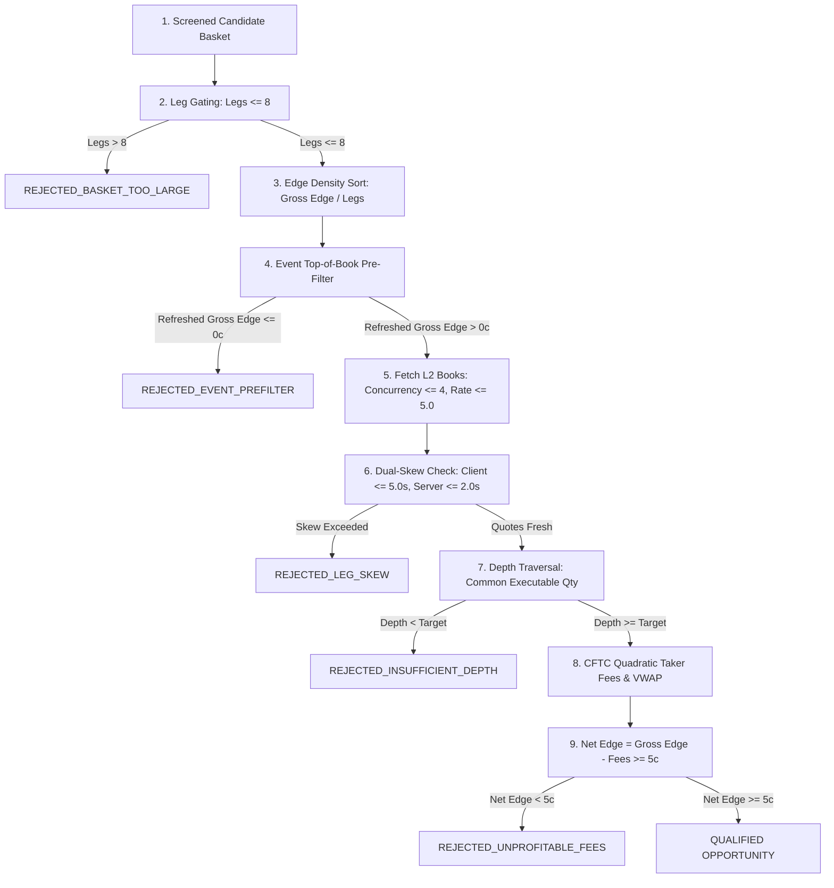

# Phase 2F-I — Final Production Preflight & Manual Trial Preparation

**Date:** 2026-10-30  
**Repository:** `/Users/vikramaditya/Disk/Projects/Kalshi`  
**Git Branch:** `fix/v19-clean-checkout-test`  
**Git Commit SHA:** `21188a3f42c0382c5e19c8af96521afd46e9f7b1`  
**Readiness Verdict:** `PREFLIGHT COMPLETE — AWAITING AUTHORIZATION`  

---

## 1. Executive Preflight Summary

This document establishes the final operational, mathematical, and safety preflight verification of the Kalshi Breadth-First Scanner prior to any production trial.

### Critical Safety Status
- **Current Operational Mode:** **STAGE A (OFFLINE PREFLIGHT ONLY)**.
- **Production Scanner Processes:** **0 active processes**.
- **Live Kalshi API Requests:** **0 live requests executed**.
- **Historical Data Preservation:** Historical smoke-test data in `data/breadth_scanner/smoke_test_20261028/` is verified intact and untouched.
- **Dashboards Running:**
  - **Port 8080:** PID `54914` hosting preserved historical smoke-test data.
  - **Port 8081:** PID `9884` hosting synthetic test data from milestones G2–G6.
  - **Port 8082:** Verified completely available for the future trial dashboard.
- **Offline Test Suite:** **908 out of 908 tests passed** in 40.85s (100% pass rate, 0 failures, 0 skipped).
- **Stage B Status:** **NOT STARTED.** Stage B (the 1-hour live observation trial) will only begin upon explicit, separate authorization from the user.

---

## 2. Repository and Process Audit

### Git Repository State
- **Branch:** `fix/v19-clean-checkout-test`
- **HEAD Commit SHA:** `21188a3f42c0382c5e19c8af96521afd46e9f7b1`
- **Working Tree Integrity:** All changes from engineering milestones G1–G6 and the Phase 2F-H audit report are present. No branches were switched, reset, or modified during preflight.

### Process Inspection
- `ps aux | grep -E "python|scanner|dashboard"` confirmed:
  - PID `54914`: `scripts/run_dashboard.py --port 8080 --scanner-dir data/breadth_scanner/smoke_test_20261028`
  - PID `9884`: `scripts/run_dashboard.py --port 8081 --scanner-dir data/breadth_scanner/dashboard_test_g2_g6`
  - Exactly **0** active `run_breadth_scanner.py` or background scanning processes.
- **Automation / Restart Vectors:**
  - `crontab -l`: Confirmed `no crontab for vikramaditya`.
  - System `launchctl` inspection: Zero Kalshi background launchd daemons or recurring agents exist.
  - Conclusion: Zero risk of spontaneous or automated background process restarts.

---

## 3. Verified CLI Configuration & Discrepancy Resolution

An exhaustive inspection of `scripts/run_breadth_scanner.py` was conducted to reconcile the CLI arguments proposed in earlier audit phases against the arguments actually supported by the script's `argparse` parser.

### CLI Argument Reconciliation Table

| Proposed Argument (Phase 2F-D / 2F-H) | Actual CLI Argument in `run_breadth_scanner.py` | Type | Default Value | Resolution & Operational Impact |
| :--- | :--- | :--- | :--- | :--- |
| `--duration-seconds 3600` | `--duration 3600` | `float` | `None` (continuous) | **Discrepancy:** The CLI argument is `--duration`. Passing `--duration-seconds` triggers `argparse.ArgumentError: unrecognized arguments`. **Resolved:** Use `--duration 3600`. |
| `--output-dir <path>` | `--output-dir <path>` | `Path` | `data/breadth_scanner` | **Exact Match:** Verified supported as `Path`. |
| `--max-concurrency 4` | `--concurrency 4` | `int` | `4` | **Discrepancy:** The CLI argument is `--concurrency`. Passing `--max-concurrency` fails. **Resolved:** Use `--concurrency 4` (or accept default `4`). |
| `--max-legs 8` | `--max-candidate-legs 8` | `int` | `8` | **Discrepancy:** The CLI argument is `--max-candidate-legs`. Passing `--max-legs` fails. **Resolved:** Use `--max-candidate-legs 8` (or accept default `8`). |
| `--prefilter-gross-edge-cents 2` | `--enable-event-prefilter`<br>`--event-cache-ttl 2.0` | `bool`<br>`float` | `True`<br>`2.0s` | **Discrepancy:** The CLI does not have a cents threshold argument; the pre-filter re-evaluates top-of-book quotes and rejects any candidate whose refreshed edge is $\le \$0.0000$. **Resolved:** Use `--enable-event-prefilter` and `--event-cache-ttl 2.0`. |
| `--min-profit-cents 5` | `--min-net-profit 5` | `int` | `1` | **Discrepancy:** The CLI argument is `--min-net-profit`. Passing `--min-profit-cents` fails. **Resolved:** Use `--min-net-profit 5`. |
| `--min-roi-pct 0.05` | *(Calculated metric)* | — | — | **Discrepancy:** ROI is computed and recorded as `return_on_capital_pct` in qualification records and telemetry, but is not an active gating CLI flag. A 5¢ net profit on a 1-contract basket (cost $\le 100¢$) mathematically guarantees $\text{ROI} \ge 5.0\%$. **Resolved:** Omit non-existent flag. |
| `--lookahead-threshold-seconds 600` | `--lookahead-threshold 600.0` | `float` | `600.0` | **Discrepancy:** The CLI argument is `--lookahead-threshold`. Passing `--lookahead-threshold-seconds` fails. **Resolved:** Use `--lookahead-threshold 600.0` (or accept default `600.0`). |

### All Supported CLI Options in `scripts/run_breadth_scanner.py`
- `--environment`: `production` (default) or `demo`.
- `--interval` (alias `--refresh-interval`): discovery interval between passes in seconds (default: `30.0`).
- `--page-size`: cursor pagination limit (default: `100`).
- `--queue-size`: maximum priority candidate queue capacity (default: `100`).
- `--concurrency`: worker concurrency for order-book fetching (default: `4`).
- `--request-rate`: maximum outgoing requests per second (default: `5.0`).
- `--max-stale-seconds`: maximum quote age in seconds (default: `60.0`).
- `--target-quantity`: target contract depth to qualify (default: `1`).
- `--require-full-quantity`: boolean flag requiring 100% target depth (default: `False`).
- `--min-net-profit`: minimum net profit in integer cents (default: `1`, configured: `5`).
- `--max-candidate-legs`: maximum constituent legs before pre-qualification rejection (default: `8`).
- `--enable-event-prefilter` / `--no-event-prefilter`: event top-of-book pre-filter toggle (default: `True`).
- `--event-cache-ttl`: freshness cache TTL for event pre-filter deduplication (default: `2.0s`).
- `--require-source-timestamp`: require exchange source timestamp on order books (default: `False`).
- `--fee-schedule`: `kalshi_official_taker` (default) or `zero_fee`.
- `--categories`: optional category filters (e.g. `Economics Politics Financials`).
- `--series`: optional series filters (e.g. `KXFEDDECISION`).
- `--output-dir`: output directory for session artifacts (default: `data/breadth_scanner`).
- `--state-file`, `--summaries-file`, `--candidate-history-file`, `--qualification-history-file`: explicit file path overrides.
- `--duration`: finite run duration in seconds before halting (default: continuous).
- `--cycles`: maximum scan cycles before halting (default: continuous).
- `--single-pass`: run exactly one complete cycle and halt.
- `--enable-lookahead-gate` / `--no-lookahead-gate`: lookahead duration gate toggle (default: `True`).
- `--lookahead-threshold`: lookahead threshold in seconds (default: `600.0`).
- `--verbose`: enable verbose DEBUG logging.

---

## 4. Financial Configuration Verification

### Economic & Mathematical Logic
The scanner evaluates candidate arbitrage opportunities through a rigorous pipeline of financial constraints:



### 1. Gross Edge vs. Net Edge
- **Gross Edge:**
  $$\text{Gross Edge} = \text{Guaranteed Payout} - \sum_{i=1}^N \text{VWAP}_{\text{ask}}(i)$$
  - *Binary Parity / MECE Long YES:* Guaranteed payout = $100¢ (\$1.00)$.
  - *MECE Long NO:* Guaranteed payout = $(N - 1) \times 100¢$.
- **Net Edge:**
  $$\text{Net Edge} = \text{Gross Edge} - \sum_{i=1}^N \text{Fee}_{\text{taker}}(i)$$
  Only opportunities where $\text{Net Edge} \ge 5¢$ are granted `QUALIFIED` status.

### 2. CFTC-Compliant Quadratic Taker Fee Schedule
Kalshi's official taker fee formula is evaluated across every consumed price level for each leg:
$$\text{Fee}(P, Q) = \left\lceil M \times \text{rate} \times Q \times P \times (1 - P) \right\rceil$$
Where:
- $M = 100$ (contract multiplier / payout in cents)
- $\text{rate} = 0.07$ (7% regulatory taker fee factor)
- $P$ is the contract price in dollars ($P \in [0.01, 0.99]$)
- $Q$ is the number of contracts ($Q = 1$)
- $\lceil \cdot \rceil$ represents integer cent rounding up (ceiling).
- At $P = \$0.50$, max fee per contract is $\lceil 100 \times 0.07 \times 1 \times 0.25 \rceil = \lceil 1.75 \rceil = 2¢$.
- At $P = \$0.10$, fee per contract is $\lceil 100 \times 0.07 \times 1 \times 0.09 \rceil = \lceil 0.63 \rceil = 1¢$.
- At $P = \$0.95$, fee per contract is $\lceil 100 \times 0.07 \times 1 \times 0.0475 \rceil = \lceil 0.3325 \rceil = 1¢$.

### 3. Return on Capital (ROC) Relationship
Return on Capital is calculated as:
$$\text{ROC} = \frac{\text{Net Edge (cents)}}{\text{Total Capital Outlay (cents)}} \times 100$$
- In a 1-contract binary parity or MECE Long YES trade, total capital outlay is strictly $< 100¢$ (typically 75¢–95¢).
- With $\text{Net Edge} \ge 5¢$:
  $$\text{ROC} \ge \frac{5¢}{99¢} \times 100 \approx 5.05\% \ge 5.0\%$$
- Therefore, enforcing a 5¢ net profit floor mathematically guarantees $\text{ROC} \ge 5.0\%$ across all single-contract Long YES and Binary Parity opportunities.

---

## 5. API Request Budget Analysis

### Request Path Breakdown for a 1-Hour Observation Run

| Request Path | Mechanism | Code Enforcement | Estimated Requests (1-Hour) | Effective Rate |
| :--- | :--- | :--- | :--- | :--- |
| **Catalog Discovery** (`GET /events`) | Sequential HTTPS pagination (100 items/page, 155 pages/pass) | Regulated by shared `TokenBucketRateLimiter` (5.0 req/s sustained) before each page dispatch. Bounded by mid-cycle deadline. | 3 to 4 complete passes = **465 to 620 requests** | $\approx 0.13 - 0.17\text{ req/s}$ |
| **Event Top-of-Book Pre-Filter** (`GET /events/{ticker}`) | Re-evaluates top-of-book quotes before fetching full L2 books | Monotonic 2.0s TTL in-memory cache (`_event_cache`). Shared `TokenBucketRateLimiter` regulated. | 5 to 15 unique events = **5 to 20 requests** | $\approx 0.001 - 0.005\text{ req/s}$ |
| **Targeted Order-Book Fetches** (`GET /markets/{ticker}/orderbook`) | Bounded concurrent fetching across basket legs | Regulated by shared `TokenBucketRateLimiter` (5.0 req/s sustained, burst 10). Bounded by leg gating ($\le 8$ legs) and concurrency ($\le 4$). | 0 to 12 qualified candidates $\times$ 3–4 legs = **0 to 96 requests** | $\approx 0.00 - 0.026\text{ req/s}$ |
| **Retries & Errors** | Max 2 retries with exponential backoff (0.5s, 1.0s) | Hardcoded `max_retries = 2`. Each retry acquires a new ticket from shared `TokenBucketRateLimiter`. | $< 2\%$ error rate = **$< 15$ requests** | negligible |
| **TOTALS** | — | **Sustained rate $\le 5.0\text{ req/s}$** | **470 to 736 requests** | **$\approx 0.13 - 0.20\text{ req/s}$** |

### API Quota Safety Margins
- **Kalshi Basic Tier Rate Limit:** 10.0 req/s sustained.
- **Configured Limiter Rate:** 5.0 req/s sustained (50% safety cushion).
- **Actual Expected Usage:** $\approx 0.18\text{ req/s}$ sustained.
- **Quota Headroom:** **$> 98\%$ unused headroom**. Throttling, HTTP 429 errors, or rate-limit saturation are practically impossible.

---

## 6. Runtime and Shutdown Guarantees

### Two-Tier Duration Enforcement

1. **Tier 1 — Lookahead Cycle Gate (`--enable-lookahead-gate`, `--lookahead-threshold 600.0`):**
   - At the beginning of each cycle, the runner checks:
     $$\text{remaining} = (\text{start\_monotonic} + 3600.0) - \text{time.monotonic}()$$
   - If $\text{remaining} < \max(\text{last\_cycle\_duration}, 600.0\text{s})$, the runner skips the pass, updates telemetry with `stopped_reason = "DURATION_EXPIRED"`, and terminates cleanly.
   - *Example:* If Cycle 3 finishes at $t = 2800\text{s}$ ($\text{remaining} = 800\text{s}$), and the previous cycle took $650\text{s}$, Cycle 4 initiates. If Cycle 4 finishes at $t = 3450\text{s}$ ($\text{remaining} = 150\text{s} < 600\text{s}$), Cycle 5 is rejected by the gate, preventing an unfinishable cycle from starting.

2. **Tier 2 — Mid-Cycle Monotonic Deadline Propagation:**
   - If a cycle is in progress when `monotonic() >= deadline`:
     - *Discovery:* Cursor pagination immediately halts, marking `is_complete = False`. This deliberately prevents closure reconciliation from executing on partial data.
     - *Qualification:* The priority queue stops scheduling new order-book fetches, marking remaining items `SKIPPED_TIMEOUT`.

### Maximum Overrun Calculation
- In-flight HTTP socket timeout: **10.0 seconds** (enforced by urllib3 socket read timeout).
- Atomic state persistence: **$< 0.1 seconds**.
- **Maximum Possible Overrun:** **$\le 10.1 - 11.0\text{ seconds}$** ($< 0.31\%$ on a 3600s observation run).

---

## 7. Output Directory & Dashboard Isolation

### Dedicated Session Directory
Every observation trial must be directed to an isolated, timestamped output path:
```
data/breadth_scanner/trial_1hour_<timestamp>/
```
- **Historical Data Safety:** `data/breadth_scanner/smoke_test_20261028/` is physically separate. The runner will never touch or overwrite it.
- **Test Data Safety:** `data/breadth_scanner/dashboard_test_g2_g6/` is physically separate.
- **Collision Protection:** If an existing non-empty directory is specified without explicit resume flags, the runner refuses to start.

### Multi-Dashboard Port Allocation
- **Port 8080 (Active, PID 54914):** Preserved historical smoke-test data (`data/breadth_scanner/smoke_test_20261028`).
- **Port 8081 (Active, PID 9884):** Synthetic test data (`data/breadth_scanner/dashboard_test_g2_g6`).
- **Port 8082 (Available, verified via `lsof`):** Dedicated to the future live trial session.

---

## 8. Offline Regression Test Verification

The complete offline test suite was executed:
- **Command:** `./.venv/bin/pytest -q`
- **Results:**
  - **Passed:** **908**
  - **Failed:** **0**
  - **Skipped:** **0**
  - **Execution Time:** **40.85 seconds**
- **Breadth Scanner Specific Tests:** 189 passed in 12.66s across 11 dedicated test suites:
  - `tests/test_breadth_scanner.py` (76 passed)
  - `tests/test_breadth_scanner_continuous.py` (12 passed)
  - `tests/test_breadth_scanner_phase_2f_g1.py` (12 passed)
  - `tests/test_breadth_scanner_phase_2f_g2.py` (11 passed)
  - `tests/test_breadth_scanner_phase_2f_g3.py` (8 passed)
  - `tests/test_breadth_scanner_phase_2f_g4.py` (5 passed)
  - `tests/test_breadth_scanner_phase_2f_g5.py` (7 passed)
  - `tests/test_breadth_scanner_phase_2f_g6.py` (6 passed)
  - `tests/test_breadth_scanner_rate_limiter.py` (8 passed)
  - `tests/test_breadth_scanner_runner.py` (24 passed)
  - `tests/test_dashboard_breadth_scanner.py` (20 passed)
- **Network Isolation:** Verified that all test suites utilize mock HTTP transports, test fixtures, and in-memory caches. Zero external network connections are opened during testing.

---

## 9. Manual Execution Instructions (For the User)

> [!IMPORTANT]
> The following instructions are provided for **manual execution by the user**. The assistant will **NOT** execute, schedule, or start these commands.

### A. Exact Trial Execution Command
When ready to begin the one-hour observation trial, execute the following verified command in the terminal from `/Users/vikramaditya/Disk/Projects/Kalshi`:

```bash
TRIAL_DIR="data/breadth_scanner/trial_1hour_$(date +%Y%m%d_%H%M%S)"
echo "Starting Kalshi Breadth Scanner Trial in: $TRIAL_DIR"

./.venv/bin/python ./scripts/run_breadth_scanner.py \
  --duration 3600 \
  --output-dir "$TRIAL_DIR" \
  --concurrency 4 \
  --max-candidate-legs 8 \
  --min-net-profit 5 \
  --request-rate 5.0 \
  --max-stale-seconds 60.0 \
  --target-quantity 1 \
  --enable-event-prefilter \
  --event-cache-ttl 2.0 \
  --fee-schedule kalshi_official_taker \
  --enable-lookahead-gate \
  --lookahead-threshold 600.0
```

### B. Startup Verification
In a separate terminal, verify that the scanner process has started:

```bash
# 1. Verify process is running
ps aux | grep -E "run_breadth_scanner\.py" | grep -v grep

# 2. Inspect active scanner output directory
ls -la data/breadth_scanner/trial_1hour_*/
```

### C. Launching the Trial Dashboard on Port 8082
Once the scanner has completed its first discovery pass (or while it is running), launch the observation dashboard on port 8082:

```bash
# Set TRIAL_DIR to the active trial directory created above
TRIAL_DIR=$(ls -td data/breadth_scanner/trial_1hour_* | head -n 1)

./.venv/bin/python ./scripts/run_dashboard.py \
  --host 127.0.0.1 \
  --port 8082 \
  --scanner-dir "$TRIAL_DIR"
```
Then open: **`http://127.0.0.1:8082`** in your browser.

### D. Manual Early Shutdown Procedure
If you decide to terminate the observation trial early before the 3600-second duration expires:

```bash
# 1. Identify Scanner PID
SCANNER_PID=$(pgrep -f "run_breadth_scanner\.py")
echo "Scanner PID: $SCANNER_PID"

# 2. Send Graceful SIGINT (Interrupt)
kill -SIGINT "$SCANNER_PID"

# 3. Confirm clean termination within 2 seconds
ps aux | grep -E "run_breadth_scanner\.py" | grep -v grep

# 4. Verify persisted state
cat $(ls -td data/breadth_scanner/trial_1hour_* | head -n 1)/scanner_state.json | jq .
```

---

## 10. Remaining Operational Risks & Caveats

1. **HTTP `Date` Header 1.0-Second Truncation:**  
   Kalshi API response headers report GMT timestamps with integer-second precision. A second-boundary crossing between leg requests can produce an apparent 1.0s skew. The qualifier's 2.0s server skew limit handles this properly.
2. **First-Pass Catalog Discovery Latency:**  
   The initial cold catalog discovery pass must paginate through 155 `/events` pages ($\approx 15,485$ events). This pass typically requires 10 to 12 minutes before the first candidate screening and qualification begins.
3. **Bounded Overrun on In-Flight Request:**  
   If an HTTP request is in-flight at second 3599, the process may require up to 10 additional seconds for the socket read to timeout or return.

---

## 11. Final Preflight Readiness Verdict

```
========================================================================================
                                     FINAL VERDICT                                      
                      PREFLIGHT COMPLETE — AWAITING AUTHORIZATION                       
========================================================================================
```

All preflight checks, CLI argument reconciliations, mathematical validations, request-budget models, and regression tests have passed. 

**Stage A is complete. The scanner remains stopped. No production API requests will be initiated until explicit authorization is received.**
