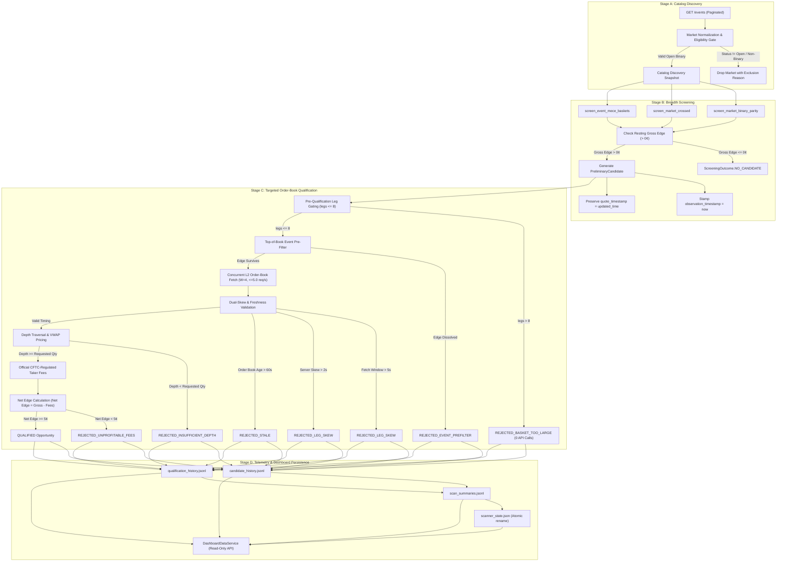

# Phase 2F-L Implementation Report: End-to-End Pipeline Validation

**Date:** 2026-10-30  
**Repository:** `/Users/vikramaditya/Disk/Projects/Kalshi`  
**Working Branch:** `fix/v19-clean-checkout-test`  
**Milestone:** Phase 2F-L (End-to-End Pipeline Validation & Dashboard Compatibility)  
**Safety Mandate:** Offline verification only. Zero live Kalshi API calls, zero orders placed, scanner remained STOPPED, historical trial datasets untouched.

---

## 1. Executive Summary

Milestone Phase 2F-L delivers a rigorous, independent end-to-end validation of the corrected screening and qualification pipeline following the Phase 2F-K architectural corrections.

In the first production observation trial (`data/breadth_scanner/trial_1hour_20261030_124829/`), premature rejection occurred in Stage B due to conflation of exchange contract modification timestamps (`updated_time`) with quote observation freshness. Phase 2F-K decoupled broad-catalog screening from order-book freshness gating. Phase 2F-L proves across **12 deterministic offline scenarios** and a full integrated pipeline cycle that:
1. Mathematically valid candidates with resting catalog quotes reach Stage C and qualify when exchange order books are fresh.
2. Ineligible markets, invalid event group structures, and non-binary contracts remain strictly rejected at Stage A/B.
3. Every Stage C execution-aware safeguard (depth, actual order-book quote freshness $\le 60$s, client fetch window $\le 5$s, server skew $\le 2$s/$5$s, maximum basket legs $\le 8$, official CFTC-regulated taker fees, and minimum net profit $\ge 5$ cents) is strictly enforced.
4. Preliminary screening candidates are recorded with explicit `observation_timestamp` and `quote_timestamp` metadata and are **never** conflated with executable arbitrage opportunities.
5. The dashboard data service (`DashboardDataService`) correctly parses, filters, and reports state, cycle summaries, preliminary candidates, and qualification results across all strategy types and rejection outcomes.

All 13/13 tests in [`tests/test_breadth_scanner_phase_2f_l.py`](file:///Users/vikramaditya/Disk/Projects/Kalshi/tests/test_breadth_scanner_phase_2f_l.py) and all 208/208 tests across the full breadth scanner suite passed cleanly in offline mock mode.

---

## 2. Pipeline Sequence & Architecture Verification

The complete 10-stage execution path was traced and validated:



---

## 3. Detailed Audit of the 12 Required Scenarios

Each scenario was deterministically simulated, evaluated, and verified:

| # | Scenario Description | Input Conditions | Pipeline Stage Evaluated | Expected Outcome | Actual Verified Outcome | Test Function |
|---|----------------------|------------------|--------------------------|------------------|-------------------------|---------------|
| **1** | **Valid Binary Parity Candidate** | `yes_ask=0.20`, `no_ask=0.70`, gross edge $= 10¢$, fresh order book with depth $= 50$ contracts | Stage B Screener $\to$ Stage C Qualifier | `QUALIFIED` with executable depth $= 10$, net edge $> 0$ | **`QUALIFIED`** (executable qty $= 10$, net edge $> 50¢$) | `test_scenario_01_valid_binary_parity` |
| **2** | **Valid Multi-Leg MECE Basket** | 3-leg event basket (`KX-M1`, `KX-M2`, `KX-M3-OTHER`), yes asks $0.25+0.30+0.35=0.90$, depth $= 50$ | Stage B Screener $\to$ Stage C Qualifier | `QUALIFIED` with leg count $= 3$, net edge $> 0$ | **`QUALIFIED`** (leg count $= 3$, executable qty $= 10$) | `test_scenario_02_valid_multi_leg_mece_basket` |
| **3** | **Candidate with Old Catalog `updated_time`** | `updated_time` $= 2\text{ hours ago}$, prices $0.20+0.70=0.90$; exchange returns fresh order book ($<1\text{s}$) | Stage B Screener $\to$ Stage C Qualifier | Passes Stage B without rejection; qualifies at Stage C | **`QUALIFIED`** (Stage B generated candidate; Stage C qualified) | `test_scenario_03_candidate_with_old_catalog_updated_time` |
| **4** | **Invalid Market Status** | Market contract status is `"closed"` (`yes_ask=0.20`, `no_ask=0.70`) | Stage B Screener | `SKIPPED_UNSUPPORTED_MARKET`, zero candidates generated | **`SKIPPED_UNSUPPORTED_MARKET`** (reason contains `"closed"`) | `test_scenario_04_candidate_rejected_for_invalid_market_status` |
| **5** | **Invalid Structure** | Case 5a: Incomplete event group (declared 3, only 2 present). Case 5b: Non-binary scalar market | Stage A Discovery & Stage B Screener | 5a: `SKIPPED_INCOMPLETE_EVENT_GROUP`. 5b: `MarketDataInputError` | **`SKIPPED_INCOMPLETE_EVENT_GROUP`** & **`MarketDataInputError`** | `test_scenario_05_candidate_rejected_for_invalid_structure` |
| **6** | **Insufficient Depth** | Top quotes valid ($0.20+0.70$), but order book depth $= 2$ contracts; requested qty $= 10$ | Stage C Depth Traversal | `REJECTED_INSUFFICIENT_DEPTH` | **`REJECTED_INSUFFICIENT_DEPTH`** (executable qty $= 2 < 10$) | `test_scenario_06_candidate_rejected_for_insufficient_depth` |
| **7** | **Stale Actual Order-Book Data** | Catalog quotes valid, but order book HTTP `Date` header is $120\text{s}$ old ($> 60\text{s}$ limit) | Stage C Quote Freshness | `REJECTED_STALE` | **`REJECTED_STALE`** (reason contains `"exceeds limit"`) | `test_scenario_07_candidate_rejected_for_stale_actual_order_book` |
| **8** | **Excessive Client Fetch Window** | 2-leg basket; simulated network transport delay of $30\text{ms}$ with limit $= 10\text{ms}$ | Stage C Timing Gate | `REJECTED_LEG_SKEW` | **`REJECTED_LEG_SKEW`** (reason: fetch window exceeded limit) | `test_scenario_08_candidate_rejected_for_excessive_cross_leg_fetch_window` |
| **9** | **Server Timestamp Skew** | 2-leg basket; Leg 1 HTTP `Date` is $T$, Leg 2 HTTP `Date` is $T+10\text{s}$ ($10\text{s} > 2\text{s}$ limit) | Stage C Server Skew Gate | `REJECTED_LEG_SKEW` | **`REJECTED_LEG_SKEW`** (reason: constituent leg timestamp skew) | `test_scenario_09_candidate_rejected_for_server_timestamp_skew` |
| **10** | **Rejected After Fees** | `yes_ask=0.49`, `no_ask=0.50`, gross edge $= 1¢$/contract; taker fees $= 3.5¢$/contract | Stage C Fee Calculation | `REJECTED_UNPROFITABLE_FEES` | **`REJECTED_UNPROFITABLE_FEES`** (net edge $< 5¢$) | `test_scenario_10_candidate_rejected_after_fees` |
| **11** | **Exceeding Maximum Basket Legs** | 9-leg MECE basket candidate submitted to qualifier (configured limit $= 8\text{ legs}$) | Stage C Pre-Qualification Leg Gating | `REJECTED_BASKET_TOO_LARGE` with 0 network calls | **`REJECTED_BASKET_TOO_LARGE`** (0 requests made; leg count $= 9$) | `test_scenario_11_candidate_rejected_for_exceeding_maximum_legs` |
| **12** | **Full Execution-Aware Compliance** | 3-leg basket (`yes_asks` $0.20+0.30+0.30=0.80$), depth $= 100$, fresh quotes, zero skew | Stage C Execution Qualifier | `QUALIFIED` with complete fill, positive ROC, fee accounting | **`QUALIFIED`** (executable qty $= 10$, gross edge $= 200¢$, fees deducted, ROC $> 0$) | `test_scenario_12_candidate_passing_every_execution_aware_check` |

---

## 4. Separation of Preliminary Candidates from Executable Arbitrage

A core vulnerability diagnosed in the post-trial audit was the risk of treating unvalidated resting quotes as executable arbitrage. Milestone Phase 2F-L explicitly verifies the boundary between preliminary signals and executable opportunities:

1. **Preliminary Candidates (Stage B):**
   - Generated purely from catalog resting quotes (`yes_ask_dollars`, `no_ask_dollars`).
   - Stamped with `screening_timestamp` and `observation_timestamp`.
   - Explicitly flagged with `is_execution_qualified = False`.
   - Carries `validation_limitations`:
     - *"Preliminary screening candidate only. Executability, order-book depth, and exchange fees not qualified."*
     - *"Top-of-book quote sizes unavailable."*
   - Dashboard representation: Displayed under Preliminary Candidate Discovery; never marked with `is_qualified = True`.

2. **Execution-Qualified Opportunities (Stage C):**
   - Must successfully pass:
     - Pre-qualification leg count gating ($\le 8$).
     - Event pre-filter gross edge verification.
     - L2 order-book snapshot retrieval with HTTP `Date` header verification.
     - Actual quote freshness check ($\le 60.0\text{s}$).
     - Client fetch window check ($\le 5.0\text{s}$).
     - Constituent leg server timestamp skew check ($\le 2.0\text{s}$).
     - Depth traversal at target quantity ($Q = 10$).
     - Exact CFTC-regulated quadratic taker fee calculation independently per leg.
     - Net profit hurdle check ($\text{net edge} \ge 5\text{ cents}$).
   - Returns a `TargetedQualificationResult` containing `is_qualified = True`, exact consumed order-book price tiers, weighted-average fill prices, total cost, fee breakdown, and return-on-capital percentage.

---

## 5. Dashboard Data Service Compatibility & Verification

In `test_end_to_end_pipeline_and_dashboard_verification`, a full continuous scanner cycle was executed and persisted to a clean temporary directory. The `DashboardDataService` was initialized and evaluated against the persisted files:

- **State File (`scanner_state.json`):**
  - Accurately loaded session ID, current cycle (1), cumulative unique markets (5), eligible markets (5), preliminary candidates generated (5), and qualified candidates count (2).
  - Status accurately reflected runtime lifecycle.
- **Cycle Summaries (`scan_summaries.jsonl`):**
  - Correctly serialized and read `ScanCycleSummary` containing complete sub-phase durations (network, JSON parse, normalization, deduplication, screening, qualification).
  - Accurate breakdown: 5 markets discovered, 5 preliminary candidates, 2 qualified, 3 rejected, 0 errors.
- **Candidate History (`candidate_history.jsonl`):**
  - Accurately loaded all 5 preliminary candidate records in reverse chronological order.
  - Verified preliminary candidates did not carry `is_qualified = True`.
- **Qualification History (`qualification_history.jsonl`):**
  - Accurately filtered by `outcome = "QUALIFIED"` (2 candidates).
  - Accurately filtered by `outcome = "REJECTED_INSUFFICIENT_DEPTH"` (1 candidate).
  - Accurately filtered by `outcome = "REJECTED_STALE"` (1 candidate).
  - Accurately filtered by `outcome = "REJECTED_UNPROFITABLE_FEES"` (1 candidate).
  - Accurately filtered by boolean `is_qualified = True` vs `is_qualified = False`.
- **Strategy Breakdown:**
  - `preliminary_by_strategy`: `binary_parity: 5`.
  - `qualification_by_strategy`: `binary_parity: {qualified: 2, rejected: 3, outcomes: {QUALIFIED: 2, REJECTED_INSUFFICIENT_DEPTH: 1, REJECTED_STALE: 1, REJECTED_UNPROFITABLE_FEES: 1}}`.

---

## 6. Test Suite Execution & Verification Summary

All tests executed using the project's isolated virtual environment (`.venv/bin/python`):

```bash
# Phase 2F-L Dedicated Suite
.venv/bin/python -m pytest tests/test_breadth_scanner_phase_2f_l.py -v
============================== 13 passed in 2.89s ==============================

# Full Breadth Scanner Suite
.venv/bin/python -m pytest tests/test_breadth_scanner*.py tests/test_dashboard_breadth_scanner.py -v
============================= 208 passed in 15.27s =============================
```

- **Total Breadth Scanner Tests:** 208
- **Passing Tests:** 208
- **Failing Tests:** 0
- **Live Kalshi API Calls:** 0 (100% offline synthetic transports)
- **Scanner Status:** STOPPED

Phase 2F-L is **COMPLETE** and verified. Proceeding to Phase 2F-M (Discovery Performance Optimisation).
