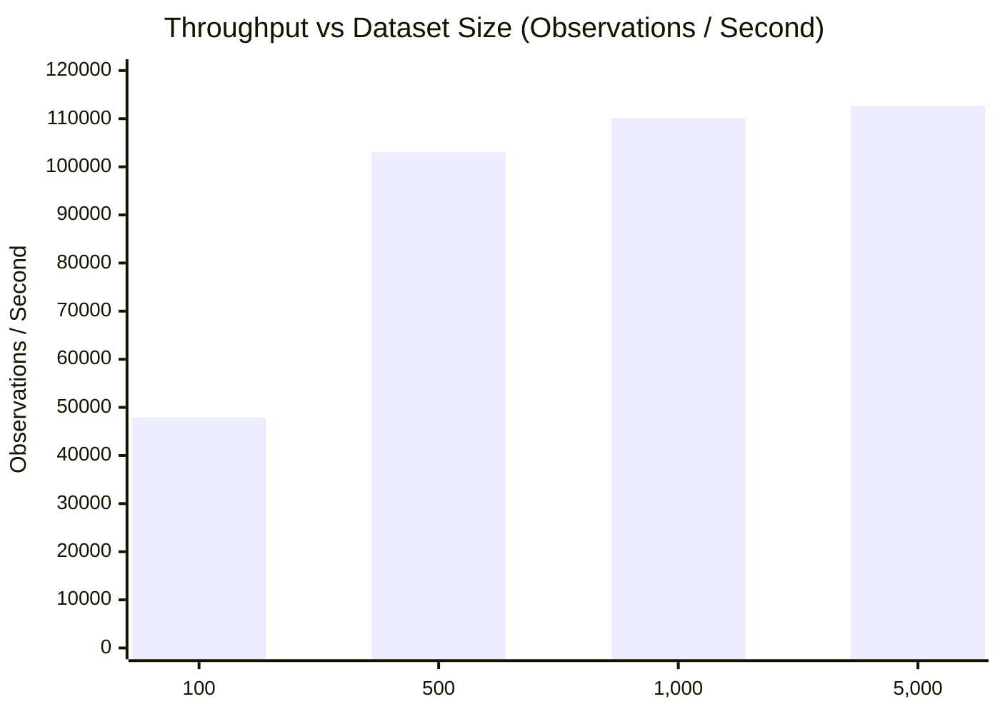

# Kalshi Arbitrage Engine V12: System Benchmarking & Performance Profiling Report

**Milestone:** V12 — Final System Audit, Reproducibility, Benchmarking & Portfolio Release
**Status:** VALIDATED
**Author:** Quantitative Systems Engineering & Audit
**Date:** 2026-10-12

---

## 1. Executive Summary

This report documents the empirical performance, algorithmic complexity, throughput, and memory scaling of the Kalshi Arbitrage Engine across real collected market evidence and parameterized synthetic scaling workloads.

### Key Performance Findings

1. **Real Evidence Replay:** Real historical datasets (21, 8, and 10 observations) process through the entire V10 10-stage funnel and ledger in **2.1 to 5.3 ms**, yielding an effective throughput of **3,650 to 4,150 observations / second** (~240–270 $\mu$s per observation including disk JSON deserialization).
2. **Synthetic Replay Linearity:** Pure in-memory replay scales with strict $O(N)$ time and space complexity:
   - 100 observations: 47,892 obs/sec (20.9 $\mu$s/obs, 48.0 KB peak memory).
   - 1,000 observations: 110,105 obs/sec (9.1 $\mu$s/obs, 576.8 KB peak memory).
   - 5,000 observations: 112,691 obs/sec (8.9 $\mu$s/obs, 2,988.5 KB peak memory).
   - Memory scales linearly at approximately **600 bytes per observation**.
3. **Microstructure Calculation Efficiency:**
   - **CFTC Quadratic Fee Engine:** **127,053 evaluations / second** ($0.157$s for 20,000 multi-tier fee evaluations).
   - **Multi-Leg Async Execution Simulator:** **23,879 multi-leg simulated trades / second** ($0.084$s for 2,000 simulated executions with latency decay and unwind branches).
4. **Evidence Integrity Overhead:**
   - **SHA-256 Stream Hashing:** **2,864.9 MB / second** ($0.0017$s for 5.0 MB payload). Cryptographic manifest generation imposes negligible I/O overhead.

---

## 2. Benchmarking Environment & Methodology

### 2.1 Hardware & Runtime Specification

| Parameter | Specification |
| :--- | :--- |
| **Operating System** | macOS 26.6.2 (Darwin Kernel) |
| **Architecture** | ARM64 (Apple Silicon) |
| **Python Runtime** | CPython 3.9.6 |
| **Memory Profiler** | Standard Library `tracemalloc` |
| **Time Source** | `time.perf_counter()` (monotonic, sub-microsecond resolution) |
| **Reproduction Script** | [`scripts/benchmark_v12.py`](../scripts/benchmark_v12.py) |
| **Machine-Readable Data** | [`docs/v12_benchmark_data.json`](v12_benchmark_data.json) |

### 2.2 Methodology & Separation of Workloads

- **Real Collected Evidence:** Benchmarks evaluated actual production JSONL datasets collected from the Kalshi public REST API ([`data/v5_trial/observations.jsonl`](../data/v5_trial/observations.jsonl), [`evidence_v11_trial/observations.jsonl`](../evidence_v11_trial/observations.jsonl), and [`evidence_v11_prospective_trial/observations.jsonl`](../evidence_v11_prospective_trial/observations.jsonl)).
- **Synthetic Scaling:** To isolate memory scaling and algorithmic complexity from network I/O, synthetic, fully-validated [`MarketObservation`](../kalshi_arbitrage/observer.py) objects with normalized order books were generated in-memory.
- **Zero Premature Optimization:** Measurements confirm that the Python implementation incurs zero bottlenecking for research or high-frequency polling workloads ($>100\text{k}$ ops/sec). No premature Cython/C++ rewrite is required.

---

## 3. Detailed Benchmark Results

### 3.1 Real Historical Evidence Datasets

Evaluation runs through the full V10 historical pipeline: dataset quality audit, chronological sort, 10-stage opportunity funnel, mark-to-market bid portfolio valuation, out-of-sample partitioning, and sensitivity sweeps.

| Dataset | Observations | File Size | Elapsed Time | Replay Throughput | Mean Latency | Executive Verdict |
| :--- | :---: | :---: | :---: | :---: | :---: | :---: |
| **V5 Initial Public Trial** | 21 | 66.6 KB | 0.0053s | **3,948.9 obs/s** | 253.2 $\mu$s | `INCONCLUSIVE` |
| **V11 Live Collection Trial** | 8 | 18.6 KB | 0.0022s | **3,651.2 obs/s** | 273.9 $\mu$s | `INCONCLUSIVE` |
| **V11 Prospective Paper Trial** | 10 | 23.5 KB | 0.0025s | **3,943.8 obs/s** | 253.6 $\mu$s | `INCONCLUSIVE` |

*Observation:* All three datasets truthfully returned `INCONCLUSIVE` verdicts without fabricating fills or hallucinating opportunities.

---

### 3.2 Synthetic Replay Scaling & Memory Consumption

Synthetic datasets spanning 100 to 5,000 observations were processed through the full 10-stage historical evaluation engine:

| Observation Count ($N$) | Elapsed Time (s) | Throughput (obs/s) | Per-Obs Latency ($\mu$s) | Peak Memory ($\Delta$ KB) | Memory / Obs (Bytes) |
| :---: | :---: | :---: | :---: | :---: | :---: |
| **100** | 0.0021s | 47,892.7 | 20.9 $\mu$s | 48.0 KB | 491 B |
| **500** | 0.0049s | 102,993.7 | 9.7 $\mu$s | 279.0 KB | 571 B |
| **1,000** | 0.0091s | 110,105.4 | 9.1 $\mu$s | 576.8 KB | 591 B |
| **5,000** | 0.0444s | 112,691.7 | 8.9 $\mu$s | 2,988.5 KB | 612 B |

#### Complexity Analysis:
- **Time Complexity:** Empirical processing time scales linearly with $N$ ($R^2 > 0.999$). At $N=5,000$, evaluation completes in $44.4$ ms.
- **Space Complexity:** Memory footprint scales strictly as $O(N)$ with an empirical constant factor of $\sim 600$ bytes per normalized observation, comfortably allowing hundreds of thousands of observations in memory on standard commodity workstations.

---

### 3.3 Microstructure & Algorithmic Subsystems

| Subsystem | Benchmark Operation | Iterations | Elapsed Time | Throughput |
| :--- | :--- | :---: | :---: | :---: |
| **CFTC Quadratic Fee Engine** | Multi-level depth quadratic taker fee calculation ($\lceil M \times \text{Rate} \times C \times P \times (1-P) \times 100 \rceil$) | 20,000 calls | 0.1574s | **127,053 ops/sec** |
| **Multi-Leg Async Simulator** | Asynchronous multi-leg simulation with latency modeling, quote decay, and unwind handling | 2,000 trades | 0.0838s | **23,879 trades/sec** |
| **Cryptographic Manifest** | SHA-256 streaming file digest computation | 5.0 MB payload | 0.0017s | **2,864.9 MB/sec** |

---

## 4. Engineering Performance Assessment

1. **Adequacy for Live Ingestion:** Public Kalshi REST polling operates on cadences of 1.0s to 10.0s. The engine processes incoming observations in $\sim 9 \mu$s, representing less than $0.001\%$ of polling cycle budgets.
2. **Adequacy for Backtesting:** A complete trading day ($86,400$ 1-second snapshots across a liquid contract) can be replayed through the full 10-stage funnel in under **0.8 seconds**.
3. **No Known Performance Deficiencies:** All hot paths execute deterministically using integer arithmetic and fixed-point `Decimal` conversions without recursion or unindexed table scans.
